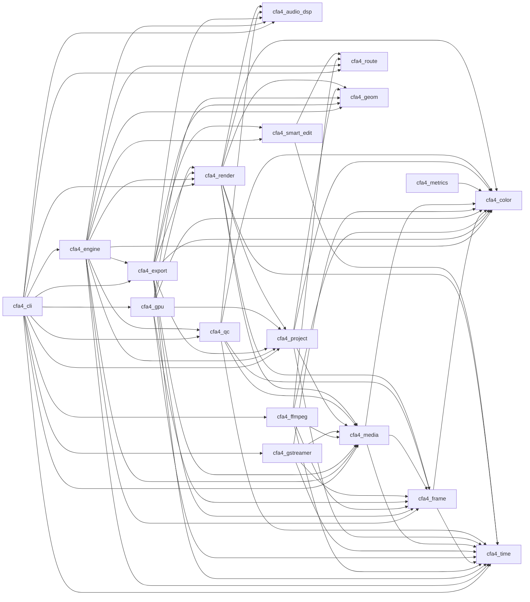

# Render-terület: géppel generált call graph és típustérkép (F0a)

> **Generált fájl, kézzel ne szerkeszd.** Forrás: `python/cfa4_devtools/render_inventory.py`
> (`CFA4-RENDER-INTEGRATION-PLAN-001`, F0a 4. feladat). Újragenerálás:
> `python3 python/cfa4_devtools/render_inventory.py`; frissesség: `--check`.
> Statikus, modulszintű gráf: egy másik crate elemére való hivatkozás él, függetlenül attól,
> hogy egy adott úton meghívódik-e. Tesztek, benchek, példák és kommentsorok kimaradnak.

## 1. Crate-függőségek (workspace-en belül, a render-területen)

| Crate | Könyvtár | Leírás |
|---|---|---|
| `cfa4-audio-dsp` | `crates/audio-dsp` | Real-time audio DSP for CFA4: BS.1770 / EBU R128 loudness metering and audio effects |
| `cfa4-cli` | `apps/cfa4-cli` | CFA4 headless CLI and MCP server |
| `cfa4-color` | `crates/color` |  |
| `cfa4-engine` | `crates/engine` | CFA4 engine façade: session, command registry, history, media pool |
| `cfa4-export` | `crates/export` | Export pipeline: parallel render → encode → mux, presets, progress/cancel |
| `cfa4-ffmpeg` | `crates/ffmpeg` | FFmpeg (>= 9.0.2) supplementary media backend for CFA4 (layer L5): probes the FFmpeg the build links, opens media the Rust engine cannot open and decodes it at its native bit depth, as a fallback behind the own engine (ADR 0005) |
| `cfa4-frame` | `crates/frame` | Video frames and audio buffers with explicit colour metadata |
| `cfa4-geom` | `crates/geom` |  |
| `cfa4-golden` | `crates/golden` | Golden-image tests for the CPU renderer/compositor and GPU-vs-CPU parity (test-only crate) |
| `cfa4-gpu` | `crates/gpu` | wgpu compositor: YUV/RGB layer sampling, linear-light premultiplied compositing in WGSL |
| `cfa4-gstreamer` | `crates/gstreamer` | Optional GStreamer backend for CFA4 (layer L5): probes the system's GStreamer installation and reads media information through it, as a supplement to the Rust media engine |
| `cfa4-media` | `crates/media` | Media sources: probing, decoding traits, frame cache, generators, stills |
| `cfa4-metrics` | `crates/metrics` |  |
| `cfa4-project` | `crates/project` | CFA4 document model: projects, bins, clips, sequences, tracks, effects, keyframes, markers |
| `cfa4-qc` | `crates/qc` | CFA4 media quality control (layer L3): versioned QC report schema, QC profiles with thresholds, file hashing, verdicts that never pass a skipped or missing mandatory check |
| `cfa4-render` | `crates/render` | Sequence evaluation and CPU reference compositor (linear-light premultiplied f32) |
| `cfa4-route` | `crates/route` | CFA4 compute router (layer L1): per-task choice of GPU, NPU or CPU backend from a routing table, the device inventory and user preferences, with recorded reasons and fallback order |
| `cfa4-smart-edit` | `crates/smart-edit` | CFA4 Smart Cut / Smart Render planning (layer L3): media capability registry, GOP indexing and render plans for lossless packet-copy and boundary re-encode exports |
| `cfa4-testkit` | `crates/testkit` | Test-only helpers: ffmpeg/ffprobe and AVM (AV2) oracle discovery, fixture directories, golden-image comparison |
| `cfa4-time` | `crates/time` |  |

## 2. Modulszintű hivatkozások crate-ek között

| Modul | Hivatkozott crate | Elemek |
|---|---|---|
| `cfa4-cli/codecs_cmd.rs` | `cfa4-export` | `Format`, `available` |
| `cfa4-cli/codecs_cmd.rs` | `cfa4-gstreamer` | `compiled_in`, `probe` |
| `cfa4-cli/main.rs` | `cfa4-engine` | `Session`, `autosave`, `media_pool`, `render` |
| `cfa4-cli/main.rs` | `cfa4-export` | `FrameRenderer`, `register_frame_renderer` |
| `cfa4-cli/main.rs` | `cfa4-ffmpeg` | `register`, `register_status` |
| `cfa4-cli/main.rs` | `cfa4-gpu` | `ExportRenderer` |
| `cfa4-cli/main.rs` | `cfa4-gstreamer` | `register`, `register_status` |
| `cfa4-cli/main.rs` | `cfa4-media` | `FrameRequest` |
| `cfa4-cli/main.rs` | `cfa4-project` | `ItemId`, `Project` |
| `cfa4-cli/main.rs` | `cfa4-render` | `Image`, `RenderOptions`, `SourceProvider` |
| `cfa4-cli/main.rs` | `cfa4-time` | `Tick` |
| `cfa4-cli/probe.rs` | `cfa4-media` | `MediaSource`, `open_with_fallback`, `sequence`, `wav` |
| `cfa4-cli/probe.rs` | `cfa4-time` | `FrameRate` |
| `cfa4-cli/qc.rs` | `cfa4-qc` | `Expectation`, `check_file_with_outputs`, `profile`, `report` |
| `cfa4-cli/serve.rs` | `cfa4-audio-dsp` | `LoudnessMeter`, `channels` |
| `cfa4-cli/serve.rs` | `cfa4-engine` | `DisplayRenderer`, `Event`, `clip_ops`, `mixer`, `voiceover` |
| `cfa4-cli/serve.rs` | `cfa4-gpu` | `ExportRenderer` |
| `cfa4-cli/serve.rs` | `cfa4-media` | `cancel` |
| `cfa4-cli/serve.rs` | `cfa4-project` | `ItemId`, `ItemKind`, `Project`, `par_ratio` |
| `cfa4-cli/serve.rs` | `cfa4-render` | `Image`, `RenderOptions`, `SourceProvider`, `audio`, `mixer`, `render_item` |
| `cfa4-cli/serve.rs` | `cfa4-time` | `FrameRate`, `TICKS_PER_SECOND`, `Tick`, `parse_timecode` |
| `cfa4-cli/serve_graphics.rs` | `cfa4-engine` | `Session` |
| `cfa4-cli/serve_graphics.rs` | `cfa4-project` | `ClipId`, `graphic`, `gtemplate` |
| `cfa4-cli/serve_graphics.rs` | `cfa4-time` | `Tick` |
| `cfa4-cli/serve_lumetri.rs` | `cfa4-engine` | `Session` |
| `cfa4-cli/serve_lumetri.rs` | `cfa4-project` | `ClipId`, `Param` |
| `cfa4-cli/serve_lumetri.rs` | `cfa4-render` | `effects`, `lumetri_presets`, `luts` |
| `cfa4-cli/serve_lumetri.rs` | `cfa4-time` | `Tick` |
| `cfa4-cli/serve_media_browser.rs` | `cfa4-engine` | `Session`, `media_browser` |
| `cfa4-cli/serve_media_browser.rs` | `cfa4-media` | `MediaInfo` |
| `cfa4-cli/serve_media_browser.rs` | `cfa4-project` | `ItemId` |
| `cfa4-cli/serve_media_browser.rs` | `cfa4-render` | `render_item` |
| `cfa4-cli/serve_media_browser.rs` | `cfa4-testkit` | `fixtures_dir`, `golden` |
| `cfa4-cli/serve_media_browser.rs` | `cfa4-time` | `Tick` |
| `cfa4-cli/serve_multicam.rs` | `cfa4-engine` | `Session`, `multicam` |
| `cfa4-cli/serve_multicam.rs` | `cfa4-project` | `ItemId` |
| `cfa4-cli/serve_multicam.rs` | `cfa4-render` | `multicam` |
| `cfa4-cli/serve_multicam.rs` | `cfa4-time` | `Tick` |
| `cfa4-cli/serve_project.rs` | `cfa4-engine` | `Session`, `keyboard`, `project_panel` |
| `cfa4-cli/serve_project.rs` | `cfa4-media` | `Generator`, `MediaKind` |
| `cfa4-cli/serve_project.rs` | `cfa4-project` | `Bin` |
| `cfa4-cli/serve_project.rs` | `cfa4-render` | `offline` |
| `cfa4-cli/serve_project.rs` | `cfa4-time` | `Tick` |
| `cfa4-cli/serve_scopes.rs` | `cfa4-engine` | `Session`, `scopes` |
| `cfa4-cli/serve_scopes.rs` | `cfa4-time` | `Tick` |
| `cfa4-cli/serve_shuttle.rs` | `cfa4-audio-dsp` | `AudioEffect` |
| `cfa4-cli/serve_tcsync.rs` | `cfa4-engine` | `Session` |
| `cfa4-cli/serve_tcsync.rs` | `cfa4-time` | `FrameRate`, `Tick` |
| `cfa4-cli/serve_text.rs` | `cfa4-engine` | `Session`, `transcript` |
| `cfa4-cli/serve_text.rs` | `cfa4-project` | `CaptionFormat`, `graphic` |
| `cfa4-cli/serve_text.rs` | `cfa4-time` | `Tick` |
| `cfa4-cli/serve_tts.rs` | `cfa4-engine` | `Session` |
| `cfa4-cli/settings_cmd.rs` | `cfa4-engine` | `Session`, `autosave` |
| `cfa4-cli/settings_cmd.rs` | `cfa4-media` | `backend_enabled`, `set_backend_enabled` |
| `cfa4-cli/settings_cmd.rs` | `cfa4-route` | `Backend`, `DeviceId`, `Error`, `Preferences`, `catalog`, `coverage`, `probe` |
| `cfa4-engine/aaf_omf.rs` | `cfa4-export` | `ExportSettings`, `Format`, `OutputSink`, `export` |
| `cfa4-engine/aaf_omf.rs` | `cfa4-project` | `ClipId` |
| `cfa4-engine/aaf_omf.rs` | `cfa4-time` | `Tick` |
| `cfa4-engine/autosave.rs` | `cfa4-project` | `AudioType`, `EssentialSound`, `Project` |
| `cfa4-engine/beat_markers.rs` | `cfa4-audio-dsp` | `remix` |
| `cfa4-engine/beat_markers.rs` | `cfa4-project` | `ClipId`, `TrackItem` |
| `cfa4-engine/beat_markers.rs` | `cfa4-render` | `remix` |
| `cfa4-engine/beat_markers.rs` | `cfa4-time` | `Tick` |
| `cfa4-engine/captions.rs` | `cfa4-media` | `SharedReader` |
| `cfa4-engine/captions.rs` | `cfa4-project` | `Caption`, `CaptionAlign` |
| `cfa4-engine/captions.rs` | `cfa4-time` | `FrameRate`, `Tick` |
| `cfa4-engine/clip_ops.rs` | `cfa4-geom` | `Vec2` |
| `cfa4-engine/clip_ops.rs` | `cfa4-media` | `AudioStreamInfo`, `Generator`, `MediaInfo`, `MediaKind`, `VideoStreamInfo`, `wav` |
| `cfa4-engine/clip_ops.rs` | `cfa4-project` | `Bin`, `EffectInstance`, `Marker`, `Param`, `graphic`, `resolve_auto_points` |
| `cfa4-engine/clip_ops.rs` | `cfa4-render` | `source_size` |
| `cfa4-engine/clip_ops.rs` | `cfa4-time` | `FrameRate` |
| `cfa4-engine/color.rs` | `cfa4-color` | `ColorSpace` |
| `cfa4-engine/color.rs` | `cfa4-export` | `encode_png` |
| `cfa4-engine/color.rs` | `cfa4-geom` | `Vec2` |
| `cfa4-engine/color.rs` | `cfa4-media` | `AudioStreamInfo` |
| `cfa4-engine/color.rs` | `cfa4-project` | `ClipId`, `MAX_LUT_TEXT_BYTES`, `MAX_PIXEL_ASPECT`, `MediaRef`, `Param`, `TrackItem`, `checked_par` |
| `cfa4-engine/color.rs` | `cfa4-render` | `RenderOptions`, `color_match`, `lumetri_presets`, `luts`, `render_clip`, `render_sequence` |
| `cfa4-engine/color.rs` | `cfa4-time` | `Tick` |
| `cfa4-engine/commands.rs` | `cfa4-color` | `WorkingSpace`, `parse_hex`, `to_hex` |
| `cfa4-engine/commands.rs` | `cfa4-export` | `frame_span` |
| `cfa4-engine/commands.rs` | `cfa4-geom` | `Vec2` |
| `cfa4-engine/commands.rs` | `cfa4-media` | `DemoScene`, `Generator`, `MAX_AUDIO_STREAMS`, `MediaKind`, `SharedSource`, `backend_reports`, `fallbacks`, `generators`, `importable_extensions`, `is_importable`, `sequence` |
| `cfa4-engine/commands.rs` | `cfa4-project` | `Bin`, `BinEntry`, `BinId`, `EffectDef`, `EffectInstance`, `EffectKind`, `Interpolation`, `ItemId`, `MediaIdentity`, `Param`, `ParamDef`, `ParamKind`, `ParamValue`, `Project`, `ProjectItem`, `Sequence`, `TimeInterpolation`, `Track`, `TrackItem`, `Transition`, `TransitionId`, `conformed_size`, `effect`, `effect_defs`, `find_effect`, `graphic`, `graphic_design`, `keyframe`, `mask`, `mixer`, `plain_text`, `sane_par`, `vtransition` |
| `cfa4-engine/commands.rs` | `cfa4-render` | `luts`, `source_size` |
| `cfa4-engine/commands.rs` | `cfa4-route` | `report` |
| `cfa4-engine/commands.rs` | `cfa4-time` | `FrameRate`, `TICKS_PER_SECOND`, `TimeRange` |
| `cfa4-engine/credits.rs` | `cfa4-audio-dsp` | `remix` |
| `cfa4-engine/credits.rs` | `cfa4-export` | `encode_png` |
| `cfa4-engine/credits.rs` | `cfa4-geom` | `Affine`, `Vec2` |
| `cfa4-engine/credits.rs` | `cfa4-media` | `open_path`, `still` |
| `cfa4-engine/credits.rs` | `cfa4-project` | `ClipId`, `EffectKind`, `GraphicMeta`, `ItemKind`, `Label`, `Project`, `Track`, `TrackId`, `TrackItem`, `TrackKind`, `Transition`, `TransitionId`, `find_effect`, `graphic`, `graphic_design`, `gtemplate`, `vtransition` |
| `cfa4-engine/credits.rs` | `cfa4-render` | `SourceProvider`, `audio`, `graphic_clip`, `image` |
| `cfa4-engine/credits.rs` | `cfa4-time` | `FrameRate`, `TICKS_PER_SECOND`, `Tick`, `TimeRange` |
| `cfa4-engine/dcpomatic.rs` | `cfa4-export` | `Report` |
| `cfa4-engine/delivery_check.rs` | `cfa4-geom` | `Rect` |
| `cfa4-engine/delivery_check.rs` | `cfa4-project` | `ItemKind`, `graphic` |
| `cfa4-engine/delivery_check.rs` | `cfa4-render` | `graphic_clip`, `motion_matrix`, `source_par` |
| `cfa4-engine/delivery_check.rs` | `cfa4-time` | `Tick` |
| `cfa4-engine/demo.rs` | `cfa4-geom` | `Vec2` |
| `cfa4-engine/demo.rs` | `cfa4-media` | `DemoScene`, `MediaKind`, `generators` |
| `cfa4-engine/demo.rs` | `cfa4-project` | `ClipId` |
| `cfa4-engine/demo.rs` | `cfa4-time` | `FrameRate` |
| `cfa4-engine/dialog_defaults.rs` | `cfa4-color` | `ColorPipeline`, `WorkingSpace`, `to_hex` |
| `cfa4-engine/dialog_defaults.rs` | `cfa4-media` | `Generator` |
| `cfa4-engine/dialog_defaults.rs` | `cfa4-project` | `AudioChannelMap`, `EffectInstance`, `FieldProcessing`, `FindOp`, `MediaRef`, `TimeInterpolation`, `find`, `graphic` |
| `cfa4-engine/dialog_defaults.rs` | `cfa4-time` | `TimeDisplay`, `format_time`, `format_timecode_frames` |
| `cfa4-engine/essential_sound.rs` | `cfa4-audio-dsp` | `LoudnessMeter`, `ducking`, `normalize_gain_db` |
| `cfa4-engine/essential_sound.rs` | `cfa4-project` | `ClipId`, `essential` |
| `cfa4-engine/essential_sound.rs` | `cfa4-render` | `SourceProvider`, `audio` |
| `cfa4-engine/essential_sound.rs` | `cfa4-time` | `Tick` |
| `cfa4-engine/export_tools.rs` | `cfa4-export` | `BitrateMode`, `DCP_CONTENT_KINDS`, `DcpAspect`, `DcpImmersive`, `DcpResolution`, `Exporter`, `IMF_CONTENT_KINDS`, `IabFallback`, `Mpeg2Container`, `OutputSink`, `Progress`, `Report`, `available`, `builtin_presets`, `dcp_content_kind`, `dcp_isdcf_date`, `dcp_isdcf_name`, `dcp_language`, `export`, `export_range`, `frame_span`, `imf_content_kind`, `presets`, `probe_iab_source`, `stepped`, `unavailable_reason`, `validate_range` |
| `cfa4-engine/export_tools.rs` | `cfa4-project` | `ItemId`, `Sequence`, `legacy` |
| `cfa4-engine/export_tools.rs` | `cfa4-qc` | `QcProfile` |
| `cfa4-engine/export_tools.rs` | `cfa4-time` | `FrameRate` |
| `cfa4-engine/eyedropper.rs` | `cfa4-color` | `linear_to_srgb_u8`, `srgb_u8_to_linear_table` |
| `cfa4-engine/eyedropper.rs` | `cfa4-project` | `ClipId`, `ItemId`, `mask` |
| `cfa4-engine/eyedropper.rs` | `cfa4-render` | `Image`, `RenderOptions`, `render_sequence` |
| `cfa4-engine/eyedropper.rs` | `cfa4-time` | `Tick` |
| `cfa4-engine/fx_editor.rs` | `cfa4-project` | `EffectInstance`, `Param`, `effect` |
| `cfa4-engine/fx_editor.rs` | `cfa4-render` | `audio_fx` |
| `cfa4-engine/fx_editor.rs` | `cfa4-time` | `Tick` |
| `cfa4-engine/graphic_templates.rs` | `cfa4-export` | `encode_png` |
| `cfa4-engine/graphic_templates.rs` | `cfa4-geom` | `Affine` |
| `cfa4-engine/graphic_templates.rs` | `cfa4-project` | `CaptionAlign`, `CaptionAnchor`, `ClipId`, `Param`, `ParamKind`, `StyleRun`, `TrackKind`, `find_effect`, `graphic`, `graphic_design`, `gtemplate` |
| `cfa4-engine/graphic_templates.rs` | `cfa4-render` | `graphic_clip`, `image` |
| `cfa4-engine/graphic_templates.rs` | `cfa4-time` | `FrameRate`, `TICKS_PER_SECOND`, `Tick`, `TimeRange` |
| `cfa4-engine/graphics.rs` | `cfa4-geom` | `Vec2` |
| `cfa4-engine/graphics.rs` | `cfa4-project` | `ClipId`, `EffectInstance`, `Project`, `Track`, `TrackId`, `TrackItem`, `find_effect`, `graphic`, `graphic_design`, `resolve_auto_points`, `text_animator` |
| `cfa4-engine/graphics.rs` | `cfa4-render` | `graphic_clip`, `motion_matrix` |
| `cfa4-engine/graphics.rs` | `cfa4-time` | `FrameRate`, `Tick` |
| `cfa4-engine/interchange.rs` | `cfa4-project` | `ItemId`, `ProjectItem` |
| `cfa4-engine/keyboard.rs` | `cfa4-export` | `still` |
| `cfa4-engine/keyboard.rs` | `cfa4-geom` | `Vec2` |
| `cfa4-engine/keyboard.rs` | `cfa4-media` | `pending` |
| `cfa4-engine/keyboard.rs` | `cfa4-project` | `ClipId`, `ItemId`, `ProjectItem`, `Track`, `TrackItem`, `graphic`, `validate_frame_size` |
| `cfa4-engine/keyboard.rs` | `cfa4-render` | `RenderOptions`, `render_item`, `render_sequence` |
| `cfa4-engine/keyboard.rs` | `cfa4-time` | `TICKS_PER_SECOND`, `Tick` |
| `cfa4-engine/keyframe_move.rs` | `cfa4-project` | `ClipId` |
| `cfa4-engine/keyframe_move.rs` | `cfa4-time` | `Tick` |
| `cfa4-engine/legibility.rs` | `cfa4-project` | `ItemKind`, `graphic`, `validate_frame_size` |
| `cfa4-engine/legibility.rs` | `cfa4-render` | `RenderOptions`, `graphic_clip`, `output_size`, `render_sequence` |
| `cfa4-engine/legibility.rs` | `cfa4-time` | `Tick` |
| `cfa4-engine/lib.rs` | `cfa4-export` | `Exporter`, `Progress`, `Report`, `Step` |
| `cfa4-engine/lib.rs` | `cfa4-media` | `MediaError`, `MediaKind`, `SharedReader`, `SharedSource`, `reader`, `sequence` |
| `cfa4-engine/lib.rs` | `cfa4-project` | `AutomationMode`, `Caption`, `ClipId`, `EffectInstance`, `ItemKind`, `Label`, `Marker`, `ProjectView`, `SequenceView`, `TrackItem`, `TransitionId`, `validate_frame_size` |
| `cfa4-engine/lib.rs` | `cfa4-render` | `Image`, `RenderOptions`, `SourceProvider`, `output_size`, `render_sequence`, `render_sequence_rgba8` |
| `cfa4-engine/lib.rs` | `cfa4-time` | `FrameRate` |
| `cfa4-engine/live.rs` | `cfa4-export` | `encode_png` |
| `cfa4-engine/live.rs` | `cfa4-geom` | `Affine` |
| `cfa4-engine/live.rs` | `cfa4-media` | `still` |
| `cfa4-engine/live.rs` | `cfa4-project` | `ClipId`, `graphic_design`, `gtemplate` |
| `cfa4-engine/live.rs` | `cfa4-render` | `graphic_clip`, `image` |
| `cfa4-engine/live.rs` | `cfa4-time` | `TICKS_PER_SECOND`, `Tick` |
| `cfa4-engine/marker_export.rs` | `cfa4-project` | `ItemId`, `Label` |
| `cfa4-engine/marker_export.rs` | `cfa4-time` | `FrameRate`, `Tick` |
| `cfa4-engine/masks.rs` | `cfa4-export` | `Report` |
| `cfa4-engine/masks.rs` | `cfa4-geom` | `Affine` |
| `cfa4-engine/masks.rs` | `cfa4-media` | `FrameRequest` |
| `cfa4-engine/masks.rs` | `cfa4-project` | `ClipId`, `EffectKind`, `ItemId`, `ItemKind`, `Param`, `Project` |
| `cfa4-engine/masks.rs` | `cfa4-render` | `cftrack`, `source_size`, `track` |
| `cfa4-engine/masks.rs` | `cfa4-time` | `Tick` |
| `cfa4-engine/media_browser.rs` | `cfa4-media` | `MediaInfo`, `STILL_EXTENSIONS`, `audio_extensions`, `importable_extensions`, `sequence`, `video_extensions` |
| `cfa4-engine/media_browser.rs` | `cfa4-project` | `BinId`, `ItemId`, `MediaRef` |
| `cfa4-engine/media_browser.rs` | `cfa4-time` | `TimeDisplay`, `format_time` |
| `cfa4-engine/media_pool.rs` | `cfa4-frame` | `AudioBuffer` |
| `cfa4-engine/media_pool.rs` | `cfa4-media` | `FrameRequest`, `Generator`, `MediaKind`, `Result`, `SharedReader`, `generators`, `open_bytes`, `open_with_fallback`, `pending`, `reader`, `sequence`, `wav` |
| `cfa4-engine/media_pool.rs` | `cfa4-project` | `ItemId`, `ItemKind`, `Label` |
| `cfa4-engine/media_pool.rs` | `cfa4-render` | `SourceProvider`, `colorman`, `offline`, `source_size` |
| `cfa4-engine/media_pool.rs` | `cfa4-testkit` | `fixtures`, `fixtures_dir`, `oracle` |
| `cfa4-engine/media_pool.rs` | `cfa4-time` | `FrameRate`, `Tick`, `TimeRange` |
| `cfa4-engine/media_route.rs` | `cfa4-media` | `set_fallback_order` |
| `cfa4-engine/media_route.rs` | `cfa4-route` | `Backend`, `Reason`, `report` |
| `cfa4-engine/media_test_util.rs` | `cfa4-export` | `ExportSettings`, `Format`, `export` |
| `cfa4-engine/media_test_util.rs` | `cfa4-media` | `DemoScene`, `SharedSource`, `generators` |
| `cfa4-engine/media_test_util.rs` | `cfa4-project` | `ItemId`, `resolve_auto_points` |
| `cfa4-engine/media_test_util.rs` | `cfa4-time` | `FrameRate` |
| `cfa4-engine/media_watch.rs` | `cfa4-media` | `MediaKind` |
| `cfa4-engine/media_watch.rs` | `cfa4-project` | `ItemId` |
| `cfa4-engine/mixer.rs` | `cfa4-project` | `AudioChannels`, `ClipId`, `EffectInstance`, `EffectKind`, `Interpolation`, `Param`, `effect_defs`, `mixer`, `vtransition` |
| `cfa4-engine/mixer.rs` | `cfa4-render` | `SourceProvider`, `audio`, `mixer` |
| `cfa4-engine/mixer.rs` | `cfa4-time` | `TICKS_PER_SECOND` |
| `cfa4-engine/multicam.rs` | `cfa4-project` | `BinId` |
| `cfa4-engine/multicam.rs` | `cfa4-render` | `multicam` |
| `cfa4-engine/multicam.rs` | `cfa4-time` | `FrameRate` |
| `cfa4-engine/narration.rs` | `cfa4-export` | `Progress`, `Report` |
| `cfa4-engine/narration.rs` | `cfa4-project` | `ClipId` |
| `cfa4-engine/narration.rs` | `cfa4-time` | `Tick` |
| `cfa4-engine/opatom.rs` | `cfa4-media` | `SharedReader` |
| `cfa4-engine/panels.rs` | `cfa4-color` | `ColorSpace` |
| `cfa4-engine/panels.rs` | `cfa4-project` | `ClipId`, `ItemId`, `find` |
| `cfa4-engine/panels.rs` | `cfa4-time` | `FrameRate`, `Tick` |
| `cfa4-engine/paste_media.rs` | `cfa4-project` | `BinId` |
| `cfa4-engine/paste_media.rs` | `cfa4-time` | `Tick` |
| `cfa4-engine/perf.rs` | `cfa4-export` | `hw_encode_stats`, `stage_times` |
| `cfa4-engine/perf.rs` | `cfa4-frame` | `pool` |
| `cfa4-engine/perf.rs` | `cfa4-route` | `report` |
| `cfa4-engine/presets.rs` | `cfa4-geom` | `Affine` |
| `cfa4-engine/presets.rs` | `cfa4-project` | `ClipId`, `EffectKind`, `ParamKind`, `find_effect`, `graphic`, `legacy` |
| `cfa4-engine/presets.rs` | `cfa4-render` | `source_size` |
| `cfa4-engine/presets.rs` | `cfa4-time` | `TICKS_PER_SECOND` |
| `cfa4-engine/previews.rs` | `cfa4-audio-dsp` | `channels` |
| `cfa4-engine/previews.rs` | `cfa4-export` | `ExportSettings`, `Format`, `Report`, `export` |
| `cfa4-engine/previews.rs` | `cfa4-frame` | `AudioBuffer` |
| `cfa4-engine/previews.rs` | `cfa4-media` | `FrameRequest`, `reader` |
| `cfa4-engine/previews.rs` | `cfa4-project` | `ItemId` |
| `cfa4-engine/previews.rs` | `cfa4-render` | `SourceProvider`, `audio`, `mixer`, `preview` |
| `cfa4-engine/previews.rs` | `cfa4-time` | `FrameRate` |
| `cfa4-engine/program_overlay.rs` | `cfa4-geom` | `Affine` |
| `cfa4-engine/program_overlay.rs` | `cfa4-project` | `ClipId`, `graphic` |
| `cfa4-engine/program_overlay.rs` | `cfa4-render` | `graphic_clip`, `motion_matrix`, `source_par`, `source_size` |
| `cfa4-engine/program_overlay.rs` | `cfa4-time` | `Tick` |
| `cfa4-engine/project_manager.rs` | `cfa4-export` | `Format`, `Progress`, `Report`, `prores_profile` |
| `cfa4-engine/project_manager.rs` | `cfa4-media` | `MediaKind`, `SharedSource`, `open_bytes` |
| `cfa4-engine/project_manager.rs` | `cfa4-project` | `ItemId`, `MediaClip` |
| `cfa4-engine/project_manager.rs` | `cfa4-time` | `FrameRate`, `Tick` |
| `cfa4-engine/project_panel.rs` | `cfa4-color` | `ColorSpace` |
| `cfa4-engine/project_panel.rs` | `cfa4-project` | `Bin`, `MediaClip` |
| `cfa4-engine/project_panel.rs` | `cfa4-time` | `Tick` |
| `cfa4-engine/project_tools.rs` | `cfa4-export` | `Format`, `available` |
| `cfa4-engine/project_tools.rs` | `cfa4-media` | `MediaInfo`, `MediaKind`, `is_importable` |
| `cfa4-engine/project_tools.rs` | `cfa4-project` | `Bin`, `BinEntry`, `BinId`, `ClipId`, `MarkerId`, `MediaClip`, `ProjectItem`, `ProjectSettings` |
| `cfa4-engine/project_tools.rs` | `cfa4-time` | `Tick`, `format_timecode_frames` |
| `cfa4-engine/proxies.rs` | `cfa4-export` | `ExportSettings`, `export` |
| `cfa4-engine/proxies.rs` | `cfa4-media` | `MediaKind` |
| `cfa4-engine/proxies.rs` | `cfa4-project` | `IngestAction`, `Label` |
| `cfa4-engine/proxies.rs` | `cfa4-time` | `Tick` |
| `cfa4-engine/qc.rs` | `cfa4-export` | `Report` |
| `cfa4-engine/qc.rs` | `cfa4-media` | `SharedReader`, `reader` |
| `cfa4-engine/qc.rs` | `cfa4-qc` | `Expectation`, `catalog`, `check_with_outputs`, `expect`, `profile`, `report` |
| `cfa4-engine/relink.rs` | `cfa4-media` | `MediaInfo`, `SharedSource`, `is_importable` |
| `cfa4-engine/relink.rs` | `cfa4-project` | `ItemId` |
| `cfa4-engine/relink.rs` | `cfa4-render` | `offline` |
| `cfa4-engine/relink.rs` | `cfa4-time` | `Tick` |
| `cfa4-engine/remix.rs` | `cfa4-audio-dsp` | `remix` |
| `cfa4-engine/remix.rs` | `cfa4-project` | `ClipId`, `ItemKind` |
| `cfa4-engine/remix.rs` | `cfa4-render` | `SourceProvider`, `remix` |
| `cfa4-engine/remix.rs` | `cfa4-time` | `Tick`, `parse_timecode` |
| `cfa4-engine/scene_detect.rs` | `cfa4-export` | `Report` |
| `cfa4-engine/scene_detect.rs` | `cfa4-media` | `FrameRequest`, `SharedSource` |
| `cfa4-engine/scene_detect.rs` | `cfa4-project` | `ClipId`, `Project` |
| `cfa4-engine/scene_detect.rs` | `cfa4-render` | `scene` |
| `cfa4-engine/scene_detect.rs` | `cfa4-time` | `Tick` |
| `cfa4-engine/scopes.rs` | `cfa4-render` | `RenderOptions`, `render_sequence` |
| `cfa4-engine/scopes.rs` | `cfa4-time` | `Tick` |
| `cfa4-engine/sequence_extras.rs` | `cfa4-project` | `ClipId`, `Project`, `TrackItem`, `graphic` |
| `cfa4-engine/sequence_extras.rs` | `cfa4-render` | `audio` |
| `cfa4-engine/sequence_extras.rs` | `cfa4-time` | `Tick` |
| `cfa4-engine/sequence_tools.rs` | `cfa4-media` | `MediaKind` |
| `cfa4-engine/sequence_tools.rs` | `cfa4-project` | `AudioChannels`, `ItemKind`, `Sequence`, `Track`, `Transition`, `TransitionId` |
| `cfa4-engine/sequence_tools.rs` | `cfa4-time` | `FrameRate` |
| `cfa4-engine/settings.rs` | `cfa4-media` | `MediaKind`, `backend_enabled`, `registered_fallbacks`, `set_backend_enabled` |
| `cfa4-engine/settings.rs` | `cfa4-project` | `Label`, `Param`, `ParamValue`, `TrackItem` |
| `cfa4-engine/settings.rs` | `cfa4-time` | `FrameRate` |
| `cfa4-engine/shortcuts.rs` | `cfa4-project` | `legacy` |
| `cfa4-engine/smart_cut.rs` | `cfa4-export` | `audio_copy`, `boundary_reencode`, `smart_cut` |
| `cfa4-engine/smart_cut.rs` | `cfa4-media` | `SharedReader` |
| `cfa4-engine/smart_cut.rs` | `cfa4-project` | `ItemKind` |
| `cfa4-engine/smart_cut.rs` | `cfa4-smart-edit` | `av1_index`, `capabilities`, `copy_planner`, `h264_index`, `hevc_index`, `media_index`, `plan`, `timestamp` |
| `cfa4-engine/smart_cut.rs` | `cfa4-time` | `FrameRate` |
| `cfa4-engine/smart_cut_mpeg.rs` | `cfa4-export` | `boundary_reencode`, `boundary_reencode_mpeg`, `smart_cut`, `smart_cut_mpeg` |
| `cfa4-engine/smart_cut_mpeg.rs` | `cfa4-media` | `SharedReader` |
| `cfa4-engine/smart_cut_mpeg.rs` | `cfa4-smart-edit` | `capabilities`, `copy_planner`, `media_index`, `timestamp` |
| `cfa4-engine/smart_cut_mpeg.rs` | `cfa4-time` | `FrameRate` |
| `cfa4-engine/smart_render.rs` | `cfa4-color` | `ColorSpace` |
| `cfa4-engine/smart_render.rs` | `cfa4-export` | `ExportSettings`, `Pipeline`, `audio_copy`, `boundary_reencode`, `rgba_to_yuv420_8`, `smart_cut`, `timeline_audio`, `timeline_render` |
| `cfa4-engine/smart_render.rs` | `cfa4-project` | `EffectInstance`, `ItemId`, `resolve_auto_points` |
| `cfa4-engine/smart_render.rs` | `cfa4-smart-edit` | `capabilities`, `edit_decision`, `plan`, `smart_render`, `timestamp` |
| `cfa4-engine/smart_render.rs` | `cfa4-time` | `FrameRate`, `TimeRange` |
| `cfa4-engine/social.rs` | `cfa4-geom` | `Vec2` |
| `cfa4-engine/social.rs` | `cfa4-project` | `ClipId`, `Project`, `find_effect`, `par_ratio`, `sane_par` |
| `cfa4-engine/social.rs` | `cfa4-render` | `source_par`, `source_size` |
| `cfa4-engine/source_monitor.rs` | `cfa4-project` | `ClipId`, `ItemKind` |
| `cfa4-engine/source_monitor.rs` | `cfa4-time` | `FrameRate` |
| `cfa4-engine/sync.rs` | `cfa4-audio-dsp` | `sync` |
| `cfa4-engine/sync.rs` | `cfa4-media` | `AudioStreamInfo`, `MAX_AUDIO_BUFFER_BYTES` |
| `cfa4-engine/sync.rs` | `cfa4-project` | `ItemId`, `MediaClip` |
| `cfa4-engine/sync.rs` | `cfa4-time` | `FrameRate` |
| `cfa4-engine/timecode_sync.rs` | `cfa4-time` | `FrameRate` |
| `cfa4-engine/transcript.rs` | `cfa4-project` | `CaptionFormat` |
| `cfa4-engine/transcript.rs` | `cfa4-time` | `TICKS_PER_SECOND` |
| `cfa4-engine/trim.rs` | `cfa4-project` | `ClipId`, `Track` |
| `cfa4-engine/trim.rs` | `cfa4-time` | `Tick` |
| `cfa4-engine/variants.rs` | `cfa4-project` | `ItemId`, `Sequence`, `graphic`, `graphic_design` |
| `cfa4-engine/voiceover.rs` | `cfa4-project` | `ItemId`, `Sequence`, `gtemplate` |
| `cfa4-engine/voiceover.rs` | `cfa4-time` | `Tick` |
| `cfa4-export/aac_out.rs` | `cfa4-project` | `ItemId` |
| `cfa4-export/aac_out.rs` | `cfa4-render` | `SourceProvider` |
| `cfa4-export/aac_out.rs` | `cfa4-time` | `TimeRange` |
| `cfa4-export/audio_out.rs` | `cfa4-audio-dsp` | `AudioEffect`, `LoudnessMeter`, `channels`, `effects`, `normalize_gain_db` |
| `cfa4-export/audio_out.rs` | `cfa4-project` | `ItemId` |
| `cfa4-export/audio_out.rs` | `cfa4-render` | `SourceProvider`, `audio` |
| `cfa4-export/audio_out.rs` | `cfa4-time` | `TimeRange` |
| `cfa4-export/boundary_reencode.rs` | `cfa4-smart-edit` | `capabilities`, `media_index`, `plan` |
| `cfa4-export/boundary_reencode_hevc.rs` | `cfa4-smart-edit` | `capabilities`, `media_index`, `plan` |
| `cfa4-export/boundary_reencode_mpeg.rs` | `cfa4-smart-edit` | `capabilities`, `media_index`, `plan`, `timestamp` |
| `cfa4-export/dcp_iab.rs` | `cfa4-audio-dsp` | `channels` |
| `cfa4-export/dcp_out.rs` | `cfa4-color` | `srgb_to_linear` |
| `cfa4-export/dcp_out.rs` | `cfa4-project` | `gtemplate` |
| `cfa4-export/dcp_out.rs` | `cfa4-time` | `FrameRate` |
| `cfa4-export/hls_out.rs` | `cfa4-time` | `FrameRate` |
| `cfa4-export/imf_out.rs` | `cfa4-time` | `FrameRate` |
| `cfa4-export/job.rs` | `cfa4-color` | `WorkingSpace` |
| `cfa4-export/job.rs` | `cfa4-media` | `pending` |
| `cfa4-export/job.rs` | `cfa4-project` | `ItemId` |
| `cfa4-export/job.rs` | `cfa4-render` | `SourceProvider` |
| `cfa4-export/job.rs` | `cfa4-time` | `FrameRate` |
| `cfa4-export/lib.rs` | `cfa4-project` | `ItemId`, `Marker`, `MarkerKind`, `validate_frame_size` |
| `cfa4-export/lib.rs` | `cfa4-render` | `Image`, `RenderOptions`, `SourceProvider` |
| `cfa4-export/lib.rs` | `cfa4-time` | `FrameRate`, `TICKS_PER_SECOND` |
| `cfa4-export/mpeg_out.rs` | `cfa4-time` | `FrameRate` |
| `cfa4-export/mxf_out.rs` | `cfa4-time` | `FrameRate` |
| `cfa4-export/opus_out.rs` | `cfa4-project` | `ItemId` |
| `cfa4-export/opus_out.rs` | `cfa4-render` | `SourceProvider` |
| `cfa4-export/opus_out.rs` | `cfa4-time` | `TimeRange` |
| `cfa4-export/pipeline.rs` | `cfa4-color` | `OutputTransform`, `linear_to_srgb`, `srgb_to_linear` |
| `cfa4-export/pipeline.rs` | `cfa4-frame` | `pool` |
| `cfa4-export/pipeline.rs` | `cfa4-geom` | `Vec2` |
| `cfa4-export/pipeline.rs` | `cfa4-project` | `ItemId`, `validate_frame_size` |
| `cfa4-export/pipeline.rs` | `cfa4-render` | `Image`, `graphics`, `output_size`, `plan`, `render_sequence` |
| `cfa4-export/pipeline.rs` | `cfa4-time` | `FrameRate`, `Tick`, `format_timecode_frames` |
| `cfa4-export/presets.rs` | `cfa4-time` | `FrameRate` |
| `cfa4-export/raster.rs` | `cfa4-color` | `srgb_to_linear`, `srgb_u8_to_linear_table` |
| `cfa4-export/raster.rs` | `cfa4-frame` | `PixelData` |
| `cfa4-export/raster.rs` | `cfa4-media` | `FrameRequest`, `open_bytes`, `still` |
| `cfa4-export/raster.rs` | `cfa4-testkit` | `ffmpeg_or_skip`, `fixtures` |
| `cfa4-export/raster.rs` | `cfa4-time` | `FrameRate`, `Tick`, `frames_to_fields` |
| `cfa4-export/settings.rs` | `cfa4-time` | `FrameRate` |
| `cfa4-export/smart_cut.rs` | `cfa4-smart-edit` | `av1_index`, `capabilities`, `media_index`, `plan`, `timestamp` |
| `cfa4-export/smart_cut_mpeg.rs` | `cfa4-smart-edit` | `capabilities`, `media_index`, `mpeg2_index`, `plan`, `timestamp` |
| `cfa4-export/still.rs` | `cfa4-color` | `linear_to_srgb` |
| `cfa4-export/still.rs` | `cfa4-media` | `still` |
| `cfa4-export/still.rs` | `cfa4-project` | `validate_frame_size` |
| `cfa4-export/still.rs` | `cfa4-render` | `Image` |
| `cfa4-export/still.rs` | `cfa4-testkit` | `oracle` |
| `cfa4-export/timeline_audio.rs` | `cfa4-project` | `ItemId` |
| `cfa4-export/timeline_audio.rs` | `cfa4-render` | `SourceProvider` |
| `cfa4-export/timeline_audio.rs` | `cfa4-time` | `TimeRange` |
| `cfa4-export/timeline_render.rs` | `cfa4-smart-edit` | `capabilities`, `media_index`, `plan`, `smart_render`, `timestamp` |
| `cfa4-export/timeline_render.rs` | `cfa4-time` | `TICKS_PER_SECOND` |
| `cfa4-export/webm_out.rs` | `cfa4-time` | `FrameRate` |
| `cfa4-ffmpeg/backend.rs` | `cfa4-time` | `Tick` |
| `cfa4-ffmpeg/lib.rs` | `cfa4-media` | `BackendEntry`, `BackendReport`, `Fallback`, `MediaError`, `RestrictedItem`, `Result`, `SharedSource`, `backend_enabled`, `backend_reports`, `register_backend`, `register_fallback`, `set_backend_enabled` |
| `cfa4-ffmpeg/lib.rs` | `cfa4-time` | `Tick` |
| `cfa4-ffmpeg/route.rs` | `cfa4-route` | `Backend`, `Preferences` |
| `cfa4-ffmpeg/source.rs` | `cfa4-color` | `ColorInfo` |
| `cfa4-ffmpeg/source.rs` | `cfa4-frame` | `AudioBuffer` |
| `cfa4-ffmpeg/source.rs` | `cfa4-media` | `AudioStreamInfo`, `Result` |
| `cfa4-ffmpeg/source.rs` | `cfa4-time` | `FrameRate` |
| `cfa4-frame/lib.rs` | `cfa4-color` | `ColorInfo`, `DecodeTable`, `Primaries`, `Transfer` |
| `cfa4-frame/lib.rs` | `cfa4-time` | `Tick` |
| `cfa4-frame/pool.rs` | `cfa4-color` | `ColorInfo` |
| `cfa4-frame/pool.rs` | `cfa4-time` | `Tick` |
| `cfa4-gpu/export_renderer.rs` | `cfa4-export` | `FrameRenderer` |
| `cfa4-gpu/export_renderer.rs` | `cfa4-geom` | `Vec2` |
| `cfa4-gpu/export_renderer.rs` | `cfa4-media` | `Generator`, `generators` |
| `cfa4-gpu/export_renderer.rs` | `cfa4-project` | `ItemId`, `ItemKind`, `ParamValue` |
| `cfa4-gpu/export_renderer.rs` | `cfa4-render` | `Image`, `SourceMap`, `plan`, `render_sequence` |
| `cfa4-gpu/export_renderer.rs` | `cfa4-time` | `FrameRate`, `TICKS_PER_SECOND`, `Tick` |
| `cfa4-gpu/fx.rs` | `cfa4-render` | `gpufx`, `plan` |
| `cfa4-gpu/lib.rs` | `cfa4-color` | `ColorInfo`, `GpuCurve`, `GpuInputParams`, `Matrix`, `REFERENCE_WHITE_NITS` |
| `cfa4-gpu/lib.rs` | `cfa4-frame` | `Chroma`, `pool` |
| `cfa4-gpu/lib.rs` | `cfa4-geom` | `Affine` |
| `cfa4-gpu/lib.rs` | `cfa4-render` | `Blend`, `plan` |
| `cfa4-gpu/lut.rs` | `cfa4-color` | `Lut3d` |
| `cfa4-gpu/mask.rs` | `cfa4-render` | `mask` |
| `cfa4-gpu/transition.rs` | `cfa4-project` | `EffectInstance` |
| `cfa4-gstreamer/lib.rs` | `cfa4-media` | `BackendEntry`, `BackendReport`, `Fallback`, `MediaError`, `Result`, `SharedSource`, `backend_enabled`, `register_backend`, `register_fallback` |
| `cfa4-gstreamer/lib.rs` | `cfa4-time` | `FrameRate`, `TICKS_PER_SECOND` |
| `cfa4-gstreamer/source.rs` | `cfa4-color` | `ColorInfo` |
| `cfa4-gstreamer/source.rs` | `cfa4-frame` | `AudioBuffer` |
| `cfa4-gstreamer/source.rs` | `cfa4-media` | `AudioStreamInfo`, `MAX_AUDIO_STREAMS`, `Result` |
| `cfa4-gstreamer/source.rs` | `cfa4-time` | `FrameRate` |
| `cfa4-media/animated.rs` | `cfa4-color` | `ColorInfo` |
| `cfa4-media/animated.rs` | `cfa4-frame` | `AudioBuffer` |
| `cfa4-media/animated.rs` | `cfa4-time` | `FrameRate` |
| `cfa4-media/auro.rs` | `cfa4-time` | `Tick` |
| `cfa4-media/cache.rs` | `cfa4-frame` | `VideoFrame` |
| `cfa4-media/cancel.rs` | `cfa4-time` | `Tick` |
| `cfa4-media/dpx.rs` | `cfa4-color` | `ColorInfo` |
| `cfa4-media/dpx.rs` | `cfa4-frame` | `Chroma`, `default_matrix` |
| `cfa4-media/dpx.rs` | `cfa4-time` | `FrameRate`, `Tick` |
| `cfa4-media/fallback.rs` | `cfa4-color` | `ColorInfo` |
| `cfa4-media/fallback.rs` | `cfa4-time` | `FrameRate`, `Tick` |
| `cfa4-media/generators.rs` | `cfa4-color` | `ColorInfo` |
| `cfa4-media/generators.rs` | `cfa4-frame` | `AudioBuffer` |
| `cfa4-media/generators.rs` | `cfa4-time` | `FrameRate` |
| `cfa4-media/lib.rs` | `cfa4-color` | `ColorInfo`, `HdrMetadata` |
| `cfa4-media/lib.rs` | `cfa4-frame` | `AudioBuffer` |
| `cfa4-media/lib.rs` | `cfa4-time` | `FrameRate` |
| `cfa4-media/reader.rs` | `cfa4-time` | `Tick` |
| `cfa4-media/sequence.rs` | `cfa4-frame` | `AudioBuffer`, `PixelData` |
| `cfa4-media/sequence.rs` | `cfa4-time` | `FrameRate`, `Tick` |
| `cfa4-media/still.rs` | `cfa4-color` | `ColorInfo`, `Transfer`, `from_linear` |
| `cfa4-media/still.rs` | `cfa4-frame` | `AudioBuffer`, `PixelData`, `VideoFrame` |
| `cfa4-media/still.rs` | `cfa4-time` | `FrameRate`, `fields_to_frames` |
| `cfa4-media/still/dng.rs` | `cfa4-color` | `ColorInfo` |
| `cfa4-media/still/dng.rs` | `cfa4-frame` | `PixelData`, `VideoFrame` |
| `cfa4-media/still/dng.rs` | `cfa4-time` | `FrameRate`, `Tick` |
| `cfa4-media/still/exr.rs` | `cfa4-color` | `ColorInfo`, `spaces` |
| `cfa4-media/still/exr.rs` | `cfa4-frame` | `VideoFrame` |
| `cfa4-media/still/exr.rs` | `cfa4-time` | `FrameRate` |
| `cfa4-media/still/hdr.rs` | `cfa4-color` | `ColorInfo` |
| `cfa4-media/still/hdr.rs` | `cfa4-frame` | `VideoFrame` |
| `cfa4-media/still/hdr.rs` | `cfa4-time` | `FrameRate` |
| `cfa4-media/still/heic.rs` | `cfa4-color` | `ColorInfo` |
| `cfa4-media/still/heic.rs` | `cfa4-frame` | `Chroma` |
| `cfa4-media/still/heic.rs` | `cfa4-time` | `Tick` |
| `cfa4-media/still/jxl.rs` | `cfa4-color` | `ColorInfo`, `to_linear` |
| `cfa4-media/still/jxl.rs` | `cfa4-frame` | `VideoFrame` |
| `cfa4-media/still/jxl.rs` | `cfa4-time` | `FrameRate` |
| `cfa4-media/wav.rs` | `cfa4-frame` | `AudioBuffer` |
| `cfa4-media/wav.rs` | `cfa4-time` | `FrameRate`, `Tick` |
| `cfa4-metrics/lab.rs` | `cfa4-color` | `Gamut` |
| `cfa4-project/caption.rs` | `cfa4-time` | `Tick` |
| `cfa4-project/effect.rs` | `cfa4-geom` | `Vec2` |
| `cfa4-project/effect.rs` | `cfa4-time` | `Tick` |
| `cfa4-project/essential.rs` | `cfa4-time` | `Tick` |
| `cfa4-project/find.rs` | `cfa4-time` | `format_timecode_frames` |
| `cfa4-project/graphic.rs` | `cfa4-geom` | `Vec2` |
| `cfa4-project/graphic.rs` | `cfa4-time` | `Tick` |
| `cfa4-project/graphic_design.rs` | `cfa4-time` | `TICKS_PER_SECOND`, `Tick` |
| `cfa4-project/gtemplate.rs` | `cfa4-geom` | `Vec2` |
| `cfa4-project/gtemplate.rs` | `cfa4-time` | `TICKS_PER_SECOND` |
| `cfa4-project/keyframe.rs` | `cfa4-geom` | `Vec2` |
| `cfa4-project/keyframe.rs` | `cfa4-time` | `Tick` |
| `cfa4-project/lib.rs` | `cfa4-color` | `ColorPipeline`, `ColorSpace` |
| `cfa4-project/lib.rs` | `cfa4-geom` | `Vec2` |
| `cfa4-project/lib.rs` | `cfa4-media` | `DemoScene`, `Generator`, `MediaKind`, `generators` |
| `cfa4-project/lib.rs` | `cfa4-time` | `FrameRate`, `TimeDisplay` |
| `cfa4-project/mask.rs` | `cfa4-geom` | `Affine` |
| `cfa4-project/mask.rs` | `cfa4-time` | `Tick` |
| `cfa4-project/mixer.rs` | `cfa4-time` | `Tick` |
| `cfa4-project/narration.rs` | `cfa4-time` | `Tick` |
| `cfa4-project/transcript.rs` | `cfa4-time` | `Tick` |
| `cfa4-qc/audio.rs` | `cfa4-audio-dsp` | `loudness` |
| `cfa4-qc/checks.rs` | `cfa4-color` | `Transfer` |
| `cfa4-qc/checks.rs` | `cfa4-media` | `MediaInfo`, `MediaKind` |
| `cfa4-qc/checks.rs` | `cfa4-time` | `FrameRate`, `Tick`, `format_timecode_frames` |
| `cfa4-qc/hash.rs` | `cfa4-media` | `ByteReader`, `reader` |
| `cfa4-qc/inspect.rs` | `cfa4-frame` | `PixelData` |
| `cfa4-qc/inspect.rs` | `cfa4-media` | `MediaInfo`, `reader` |
| `cfa4-qc/picture.rs` | `cfa4-color` | `ColorInfo`, `Range` |
| `cfa4-qc/picture.rs` | `cfa4-frame` | `Chroma`, `PixelData` |
| `cfa4-qc/picture.rs` | `cfa4-time` | `Tick` |
| `cfa4-qc/run.rs` | `cfa4-media` | `SharedReader`, `reader` |
| `cfa4-render/audio.rs` | `cfa4-audio-dsp` | `channels` |
| `cfa4-render/audio.rs` | `cfa4-frame` | `AudioBuffer` |
| `cfa4-render/audio.rs` | `cfa4-project` | `AudioChannels` |
| `cfa4-render/audio.rs` | `cfa4-time` | `Tick` |
| `cfa4-render/audio_fx.rs` | `cfa4-audio-dsp` | `AudioEffect`, `Unit`, `create_effect`, `effect_info` |
| `cfa4-render/audio_fx.rs` | `cfa4-project` | `EffectInstance`, `EffectKind`, `ParamValue`, `effect`, `find_effect` |
| `cfa4-render/audio_fx.rs` | `cfa4-time` | `Tick` |
| `cfa4-render/blend.rs` | `cfa4-color` | `linear_to_srgb` |
| `cfa4-render/cftrack.rs` | `cfa4-geom` | `Affine` |
| `cfa4-render/cftrack.rs` | `cfa4-project` | `TrackMethod` |
| `cfa4-render/color_match.rs` | `cfa4-color` | `WorkingSpace` |
| `cfa4-render/color_match.rs` | `cfa4-geom` | `Vec2` |
| `cfa4-render/color_match.rs` | `cfa4-project` | `EffectInstance`, `Param`, `find_effect` |
| `cfa4-render/color_match.rs` | `cfa4-time` | `Tick` |
| `cfa4-render/colorman.rs` | `cfa4-color` | `ColorInfo`, `ColorPipeline`, `HdrMetadata`, `pq_inverse_eotf` |
| `cfa4-render/colorman.rs` | `cfa4-frame` | `PixelData`, `VideoFrame` |
| `cfa4-render/colorman.rs` | `cfa4-media` | `Generator`, `MediaSource`, `generators` |
| `cfa4-render/colorman.rs` | `cfa4-project` | `ItemId`, `ItemKind` |
| `cfa4-render/colorman.rs` | `cfa4-time` | `Tick` |
| `cfa4-render/effects.rs` | `cfa4-color` | `GradeSpace`, `Matrix`, `WorkingSpace`, `hsl_to_rgb`, `rgb_to_ycbcr`, `srgb_to_linear` |
| `cfa4-render/effects.rs` | `cfa4-geom` | `Affine` |
| `cfa4-render/effects.rs` | `cfa4-project` | `EffectInstance`, `EffectKind`, `ParamKind`, `Project`, `effect_defs`, `find_effect` |
| `cfa4-render/effects.rs` | `cfa4-time` | `Tick` |
| `cfa4-render/gpufx.rs` | `cfa4-color` | `Matrix`, `WorkingSpace`, `hsl_to_rgb`, `linear_to_srgb`, `rgb_to_ycbcr`, `srgb_to_linear` |
| `cfa4-render/gpufx.rs` | `cfa4-geom` | `Affine`, `Rect` |
| `cfa4-render/gpufx.rs` | `cfa4-project` | `EffectInstance`, `ParamValue` |
| `cfa4-render/gpufx.rs` | `cfa4-time` | `Tick` |
| `cfa4-render/graphic_clip.rs` | `cfa4-geom` | `Affine` |
| `cfa4-render/graphic_clip.rs` | `cfa4-project` | `EffectInstance`, `ItemKind`, `Label`, `ParamValue`, `Project`, `RollMode`, `TrackKind`, `graphic`, `graphic_design` |
| `cfa4-render/graphic_clip.rs` | `cfa4-time` | `FrameRate`, `Tick`, `TimeRange` |
| `cfa4-render/graphics.rs` | `cfa4-color` | `srgb_to_linear` |
| `cfa4-render/graphics.rs` | `cfa4-geom` | `Vec2` |
| `cfa4-render/image.rs` | `cfa4-color` | `linear_to_srgb_index`, `linear_to_srgb_u8_table` |
| `cfa4-render/image.rs` | `cfa4-frame` | `linear_premul_to_srgb8` |
| `cfa4-render/image.rs` | `cfa4-geom` | `Affine`, `Rect` |
| `cfa4-render/lib.rs` | `cfa4-color` | `ColorPipeline` |
| `cfa4-render/lib.rs` | `cfa4-frame` | `PixelData` |
| `cfa4-render/lib.rs` | `cfa4-geom` | `Affine` |
| `cfa4-render/lib.rs` | `cfa4-media` | `FrameRequest`, `MediaSource`, `cancel` |
| `cfa4-render/lib.rs` | `cfa4-project` | `ClipId`, `ItemId`, `TimeInterpolation`, `graphic`, `par_ratio`, `sane_par` |
| `cfa4-render/lib.rs` | `cfa4-time` | `FrameRate`, `Tick` |
| `cfa4-render/lumetri_presets.rs` | `cfa4-color` | `WorkingSpace`, `srgb_to_linear` |
| `cfa4-render/lumetri_presets.rs` | `cfa4-geom` | `Vec2` |
| `cfa4-render/lumetri_presets.rs` | `cfa4-project` | `EffectInstance` |
| `cfa4-render/lumetri_presets.rs` | `cfa4-time` | `Tick` |
| `cfa4-render/luts.rs` | `cfa4-color` | `ColorPipeline`, `ColorSpace`, `InputTransform`, `linear_to_srgb` |
| `cfa4-render/luts.rs` | `cfa4-project` | `MAX_LUT_TEXT_BYTES`, `ParamKind`, `ProjectLut`, `find_effect` |
| `cfa4-render/mask.rs` | `cfa4-geom` | `Vec2` |
| `cfa4-render/mask.rs` | `cfa4-project` | `EffectInstance`, `MaskPath`, `ParamValue`, `TrackItem` |
| `cfa4-render/mask.rs` | `cfa4-time` | `Tick` |
| `cfa4-render/mixer.rs` | `cfa4-audio-dsp` | `AudioEffect`, `channels`, `create_effect` |
| `cfa4-render/mixer.rs` | `cfa4-frame` | `AudioBuffer` |
| `cfa4-render/mixer.rs` | `cfa4-project` | `AudioChannels`, `mixer` |
| `cfa4-render/mixer.rs` | `cfa4-time` | `Tick`, `TimeRange` |
| `cfa4-render/multicam.rs` | `cfa4-project` | `ItemId` |
| `cfa4-render/multicam.rs` | `cfa4-time` | `Tick` |
| `cfa4-render/offline.rs` | `cfa4-geom` | `Vec2` |
| `cfa4-render/plan.rs` | `cfa4-color` | `InputTransform` |
| `cfa4-render/plan.rs` | `cfa4-frame` | `VideoFrame` |
| `cfa4-render/plan.rs` | `cfa4-geom` | `Affine` |
| `cfa4-render/plan.rs` | `cfa4-media` | `FrameRequest`, `cancel` |
| `cfa4-render/plan.rs` | `cfa4-project` | `EffectInstance`, `ItemId`, `MaskMode`, `find_effect`, `graphic` |
| `cfa4-render/plan.rs` | `cfa4-time` | `Tick`, `TimeDisplay`, `format_time` |
| `cfa4-render/preview.rs` | `cfa4-media` | `MediaKind` |
| `cfa4-render/preview.rs` | `cfa4-project` | `ClipId`, `Label`, `MediaRef` |
| `cfa4-render/preview.rs` | `cfa4-time` | `FrameRate` |
| `cfa4-render/remix.rs` | `cfa4-audio-dsp` | `remix` |
| `cfa4-render/remix.rs` | `cfa4-frame` | `AudioBuffer` |
| `cfa4-render/remix.rs` | `cfa4-project` | `EffectInstance` |
| `cfa4-render/remix.rs` | `cfa4-time` | `Tick` |
| `cfa4-render/track.rs` | `cfa4-geom` | `Affine` |
| `cfa4-render/track.rs` | `cfa4-project` | `TrackMethod` |
| `cfa4-render/transitions/legacy.rs` | `cfa4-geom` | `Affine` |
| `cfa4-render/transitions/legacy.rs` | `cfa4-project` | `EffectInstance` |
| `cfa4-render/transitions/legacy.rs` | `cfa4-time` | `Tick` |
| `cfa4-render/transitions/mod.rs` | `cfa4-color` | `srgb_to_linear` |
| `cfa4-render/transitions/mod.rs` | `cfa4-geom` | `Vec2` |
| `cfa4-render/transitions/mod.rs` | `cfa4-project` | `EffectInstance` |
| `cfa4-render/transitions/mod.rs` | `cfa4-time` | `Tick` |
| `cfa4-render/vfx/auto.rs` | `cfa4-color` | `luma709` |
| `cfa4-render/vfx/auto.rs` | `cfa4-project` | `EffectInstance` |
| `cfa4-render/vfx/blur.rs` | `cfa4-color` | `linear_to_srgb` |
| `cfa4-render/vfx/blur.rs` | `cfa4-project` | `EffectInstance` |
| `cfa4-render/vfx/color.rs` | `cfa4-color` | `Matrix`, `linear_to_srgb`, `srgb_to_linear` |
| `cfa4-render/vfx/color.rs` | `cfa4-project` | `EffectInstance`, `effect` |
| `cfa4-render/vfx/denoise.rs` | `cfa4-project` | `EffectInstance` |
| `cfa4-render/vfx/distort.rs` | `cfa4-project` | `EffectInstance` |
| `cfa4-render/vfx/glitch.rs` | `cfa4-project` | `EffectInstance` |
| `cfa4-render/vfx/immersive.rs` | `cfa4-color` | `srgb_to_linear` |
| `cfa4-render/vfx/immersive.rs` | `cfa4-project` | `EffectInstance` |
| `cfa4-render/vfx/lights.rs` | `cfa4-color` | `linear_to_srgb` |
| `cfa4-render/vfx/lights.rs` | `cfa4-project` | `EffectInstance` |
| `cfa4-render/vfx/mod.rs` | `cfa4-geom` | `Affine` |
| `cfa4-render/vfx/mod.rs` | `cfa4-project` | `EffectInstance`, `ItemKind`, `effect`, `graphic` |
| `cfa4-render/vfx/mod.rs` | `cfa4-time` | `Tick` |
| `cfa4-render/vfx/stylize.rs` | `cfa4-color` | `linear_to_srgb`, `luma709`, `rgb_to_hsl`, `srgb_to_linear` |
| `cfa4-render/vfx/stylize.rs` | `cfa4-project` | `EffectInstance` |
| `cfa4-render/vfx/stylize.rs` | `cfa4-time` | `Tick` |
| `cfa4-render/vfx/temporal.rs` | `cfa4-color` | `linear_to_srgb` |
| `cfa4-render/vfx/temporal.rs` | `cfa4-media` | `cancel` |
| `cfa4-render/vfx/temporal.rs` | `cfa4-project` | `EffectInstance` |
| `cfa4-render/vfx/text.rs` | `cfa4-project` | `EffectInstance` |
| `cfa4-smart-edit/capabilities.rs` | `cfa4-route` | `Family`, `Table`, `TaskId` |
| `cfa4-smart-edit/copy_planner.rs` | `cfa4-time` | `Tick` |
| `cfa4-smart-edit/edit_decision.rs` | `cfa4-time` | `Tick` |
| `cfa4-smart-edit/smart_render.rs` | `cfa4-time` | `TICKS_PER_SECOND` |
| `cfa4-smart-edit/timestamp.rs` | `cfa4-time` | `TICKS_PER_SECOND` |

## 3. Belépési pontok (nyilvános render/export/preview/proxy függvények)

| Crate | Modul | Függvény |
|---|---|---|
| `cfa4-audio-dsp` | `remix.rs` | `render` |
| `cfa4-audio-dsp` | `sync.rs` | `mixdown` |
| `cfa4-cli` | `serve_shuttle.rs` | `mix_rate` |
| `cfa4-cli` | `serve_tts.rs` | `preview_audio` |
| `cfa4-color` | `log.rs` | `apple_log_encode` |
| `cfa4-color` | `log.rs` | `clog2_encode` |
| `cfa4-color` | `log.rs` | `clog3_encode` |
| `cfa4-color` | `log.rs` | `dlog_encode` |
| `cfa4-color` | `log.rs` | `log3g10_encode` |
| `cfa4-color` | `log.rs` | `logc3_encode` |
| `cfa4-color` | `log.rs` | `logc4_encode` |
| `cfa4-color` | `log.rs` | `slog3_encode` |
| `cfa4-color` | `log.rs` | `vlog_encode` |
| `cfa4-color` | `transform.rs` | `encode_channel` |
| `cfa4-engine` | `aaf_omf.rs` | `export_aaf` |
| `cfa4-engine` | `aaf_omf.rs` | `export_omf` |
| `cfa4-engine` | `commands.rs` | `preview_transition` |
| `cfa4-engine` | `export_tools.rs` | `default_export_dir` |
| `cfa4-engine` | `export_tools.rs` | `export_media` |
| `cfa4-engine` | `export_tools.rs` | `spawn_export` |
| `cfa4-engine` | `interchange.rs` | `export` |
| `cfa4-engine` | `keyboard.rs` | `frame_export_target` |
| `cfa4-engine` | `perf.rs` | `export_json` |
| `cfa4-engine` | `previews.rs` | `render` |
| `cfa4-engine` | `previews.rs` | `render_audio` |
| `cfa4-engine` | `project_tools.rs` | `previews_dir` |
| `cfa4-engine` | `project_tools.rs` | `previews_dir_for` |
| `cfa4-engine` | `proxies.rs` | `proxy_dir` |
| `cfa4-engine` | `remix.rs` | `remixed_clips` |
| `cfa4-engine` | `sequence_extras.rs` | `mix_peak_db` |
| `cfa4-engine` | `settings.rs` | `previews_root` |
| `cfa4-engine` | `voiceover.rs` | `mix_cues` |
| `cfa4-export` | `audio_copy.rs` | `mux_audio_tracks` |
| `cfa4-export` | `audio_copy.rs` | `mux_with_audio` |
| `cfa4-export` | `boundary_reencode.rs` | `check_mp4_boundary_reencode` |
| `cfa4-export` | `boundary_reencode.rs` | `execute_mp4_boundary_reencode` |
| `cfa4-export` | `boundary_reencode.rs` | `verify_mp4_boundary_reencode` |
| `cfa4-export` | `boundary_reencode_mpeg.rs` | `check_mpeg_boundary_reencode` |
| `cfa4-export` | `boundary_reencode_mpeg.rs` | `execute_mpeg_boundary_reencode` |
| `cfa4-export` | `boundary_reencode_mpeg.rs` | `verify_mpeg_boundary_reencode` |
| `cfa4-export` | `lib.rs` | `encode_png` |
| `cfa4-export` | `lib.rs` | `encode_still` |
| `cfa4-export` | `lib.rs` | `encode_still_timed` |
| `cfa4-export` | `lib.rs` | `encode_still_with` |
| `cfa4-export` | `lib.rs` | `encode_still_with_quality` |
| `cfa4-export` | `lib.rs` | `encoder_registered` |
| `cfa4-export` | `lib.rs` | `export` |
| `cfa4-export` | `lib.rs` | `export_chapters` |
| `cfa4-export` | `lib.rs` | `export_lock_wait` |
| `cfa4-export` | `lib.rs` | `export_range` |
| `cfa4-export` | `lib.rs` | `frame_renderer_registered` |
| `cfa4-export` | `lib.rs` | `gpu_render_stats` |
| `cfa4-export` | `lib.rs` | `hw_encode_stats` |
| `cfa4-export` | `lib.rs` | `note_hw_encode_declined` |
| `cfa4-export` | `lib.rs` | `note_hw_encode_frame` |
| `cfa4-export` | `lib.rs` | `note_hw_encode_session` |
| `cfa4-export` | `lib.rs` | `register_audio_encoder` |
| `cfa4-export` | `lib.rs` | `register_encoder` |
| `cfa4-export` | `lib.rs` | `register_frame_renderer` |
| `cfa4-export` | `lib.rs` | `reset_export_lock_wait` |
| `cfa4-export` | `pcm.rs` | `encode` |
| `cfa4-export` | `still.rs` | `encode` |
| `cfa4-export` | `timeline_audio.rs` | `encode_sequence_audio` |
| `cfa4-media` | `generators.rs` | `render` |
| `cfa4-media` | `still/heif.rs` | `encode_png` |
| `cfa4-project` | `gtemplate.rs` | `base64_encode` |
| `cfa4-render` | `audio.rs` | `mix_sequence` |
| `cfa4-render` | `audio.rs` | `mix_sequence_layout` |
| `cfa4-render` | `blend.rs` | `composite` |
| `cfa4-render` | `blend.rs` | `composite_at` |
| `cfa4-render` | `graphic_clip.rs` | `composite_raster` |
| `cfa4-render` | `graphic_clip.rs` | `render_graphic` |
| `cfa4-render` | `graphic_clip.rs` | `render_graphic_layers` |
| `cfa4-render` | `graphic_clip.rs` | `render_graphic_tight` |
| `cfa4-render` | `lib.rs` | `render_clip` |
| `cfa4-render` | `lib.rs` | `render_item` |
| `cfa4-render` | `lib.rs` | `render_sequence` |
| `cfa4-render` | `lib.rs` | `render_sequence_rgba8` |
| `cfa4-render` | `lumetri_presets.rs` | `preview_image` |
| `cfa4-render` | `mask.rs` | `mix` |
| `cfa4-render` | `mixer.rs` | `mix_graph` |
| `cfa4-render` | `multicam.rs` | `render_angle` |
| `cfa4-render` | `multicam.rs` | `render_angle_thumbnail` |
| `cfa4-render` | `multicam.rs` | `render_grid` |
| `cfa4-render` | `multicam.rs` | `render_grid_page` |
| `cfa4-render` | `remix.rs` | `is_remixed` |
| `cfa4-smart-edit` | `smart_render.rs` | `plan_smart_render` |
| `cfa4-testkit` | `golden.rs` | `encode_png` |
| `cfa4-testkit` | `oracle.rs` | `ffmpeg_has_encoder` |
| `cfa4-testkit` | `wav.rs` | `encode_f32` |

## 4. Nyilvános típusok osztályonként

A többi 557 nyilvános típus („other” osztály) csak a `call-graph.json`-ban szerepel.

### Képkocka, kép, pixel (24)

| Crate | Modul | Fajta | Típus |
|---|---|---|---|
| `cfa4-audio-dsp` | `channels.rs` | enum | `Layout` |
| `cfa4-engine` | `keyboard.rs` | struct | `FrameExportTarget` |
| `cfa4-engine` | `sequence_tools.rs` | struct | `DuplicateFrames` |
| `cfa4-export` | `lib.rs` | struct | `EncoderFrame` |
| `cfa4-export` | `lib.rs` | trait | `FrameRenderer` |
| `cfa4-export` | `lib.rs` | type | `FrameRendererFactory` |
| `cfa4-export` | `settings.rs` | struct | `ImageOverlay` |
| `cfa4-export` | `timeline_render.rs` | trait | `RenderedFrames` |
| `cfa4-frame` | `lib.rs` | enum | `Chroma` |
| `cfa4-frame` | `lib.rs` | enum | `ChromaLocation` |
| `cfa4-frame` | `lib.rs` | struct | `FrameLayout` |
| `cfa4-frame` | `lib.rs` | enum | `PixelData` |
| `cfa4-frame` | `lib.rs` | struct | `Region` |
| `cfa4-frame` | `lib.rs` | struct | `VideoFrame` |
| `cfa4-media` | `cache.rs` | struct | `FrameCache` |
| `cfa4-media` | `lib.rs` | struct | `FrameRequest` |
| `cfa4-media` | `sequence.rs` | type | `FrameLoader` |
| `cfa4-media` | `sequence.rs` | struct | `ImageSequenceSource` |
| `cfa4-media` | `still.rs` | struct | `Raster` |
| `cfa4-render` | `graphic_clip.rs` | struct | `LayerRaster` |
| `cfa4-render` | `image.rs` | struct | `Image` |
| `cfa4-render` | `multicam.rs` | struct | `PageLayout` |
| `cfa4-render` | `plan.rs` | enum | `FramePlan` |
| `cfa4-smart-edit` | `media_index.rs` | struct | `FrameIndexEntry` |

### Idő (7)

| Crate | Modul | Fajta | Típus |
|---|---|---|---|
| `cfa4-engine` | `timecode_sync.rs` | struct | `TimecodeSyncPrefs` |
| `cfa4-qc` | `expect.rs` | struct | `Rate` |
| `cfa4-render` | `remix.rs` | struct | `TickPiece` |
| `cfa4-time` | `lib.rs` | struct | `FrameRate` |
| `cfa4-time` | `lib.rs` | struct | `Tick` |
| `cfa4-time` | `lib.rs` | enum | `TimeDisplay` |
| `cfa4-time` | `lib.rs` | struct | `TimeRange` |

### Job, sor, folyamat, megszakítás (26)

| Crate | Modul | Fajta | Típus |
|---|---|---|---|
| `cfa4-engine` | `autosave.rs` | struct | `Status` |
| `cfa4-engine` | `autosave.rs` | enum | `WorkerEvent` |
| `cfa4-engine` | `export_tools.rs` | struct | `ExportQueue` |
| `cfa4-engine` | `export_tools.rs` | struct | `QueueItem` |
| `cfa4-engine` | `export_tools.rs` | enum | `QueueStatus` |
| `cfa4-engine` | `lib.rs` | struct | `Job` |
| `cfa4-engine` | `lib.rs` | struct | `SteppedJob` |
| `cfa4-engine` | `media_pool.rs` | struct | `OfflineStatus` |
| `cfa4-engine` | `proxies.rs` | struct | `PendingJob` |
| `cfa4-engine` | `qc.rs` | enum | `QcStatus` |
| `cfa4-export` | `job.rs` | struct | `Exporter` |
| `cfa4-export` | `job.rs` | enum | `Step` |
| `cfa4-export` | `lib.rs` | struct | `Progress` |
| `cfa4-ffmpeg` | `lib.rs` | struct | `RestrictedStatus` |
| `cfa4-ffmpeg` | `lib.rs` | struct | `Status` |
| `cfa4-gstreamer` | `lib.rs` | struct | `ElementStatus` |
| `cfa4-gstreamer` | `lib.rs` | struct | `Status` |
| `cfa4-qc` | `report.rs` | enum | `RenderStatus` |
| `cfa4-qc` | `report.rs` | enum | `Status` |
| `cfa4-render` | `cftrack.rs` | struct | `CorrStep` |
| `cfa4-render` | `plan.rs` | enum | `PlanStep` |
| `cfa4-render` | `track.rs` | struct | `Step` |
| `cfa4-route` | `lib.rs` | struct | `Task` |
| `cfa4-route` | `table.rs` | struct | `TaskRule` |
| `cfa4-smart-edit` | `media_index.rs` | enum | `DependencyStatus` |
| `cfa4-testkit` | `fixtures.rs` | enum | `Status` |

### Hang (41)

| Crate | Modul | Fajta | Típus |
|---|---|---|---|
| `cfa4-audio-dsp` | `channels.rs` | struct | `Pan51` |
| `cfa4-audio-dsp` | `effects/channel.rs` | struct | `ChannelVolume` |
| `cfa4-audio-dsp` | `effects/special.rs` | struct | `AmbisonicsPanner` |
| `cfa4-audio-dsp` | `effects/special.rs` | struct | `ChannelMixer` |
| `cfa4-audio-dsp` | `effects/special.rs` | struct | `LoudnessMeterFx` |
| `cfa4-audio-dsp` | `lib.rs` | trait | `AudioEffect` |
| `cfa4-audio-dsp` | `loudness.rs` | struct | `LoudnessMeter` |
| `cfa4-audio-dsp` | `loudness.rs` | struct | `LoudnessSummary` |
| `cfa4-engine` | `aaf_omf.rs` | enum | `AudioMode` |
| `cfa4-engine` | `aaf_omf.rs` | struct | `AudioPlan` |
| `cfa4-engine` | `autosave.rs` | struct | `AudioPrefs` |
| `cfa4-engine` | `project_panel.rs` | struct | `ProjectPanelPrefs` |
| `cfa4-engine` | `settings.rs` | struct | `AudioHardwarePrefs` |
| `cfa4-engine` | `voiceover.rs` | trait | `AudioInput` |
| `cfa4-export` | `audio_copy.rs` | struct | `AudioDrop` |
| `cfa4-export` | `audio_copy.rs` | struct | `AudioPlan` |
| `cfa4-export` | `audio_copy.rs` | struct | `AudioTrackCopy` |
| `cfa4-export` | `audio_copy.rs` | struct | `AudioTrackInput` |
| `cfa4-export` | `audio_copy.rs` | struct | `AudioTrackReport` |
| `cfa4-export` | `audio_out.rs` | struct | `LoudnessReport` |
| `cfa4-export` | `lib.rs` | trait | `AudioEncoder` |
| `cfa4-export` | `lib.rs` | type | `AudioEncoderFactory` |
| `cfa4-export` | `settings.rs` | enum | `AudioCodec` |
| `cfa4-export` | `settings.rs` | struct | `AudioSettings` |
| `cfa4-export` | `settings.rs` | struct | `LoudnessNormalization` |
| `cfa4-export` | `settings.rs` | enum | `SampleFormat` |
| `cfa4-export` | `smart_cut_mpeg.rs` | struct | `MpegAudioDrop` |
| `cfa4-export` | `smart_cut_mpeg.rs` | struct | `MpegAudioReport` |
| `cfa4-export` | `smart_cut_mpeg.rs` | struct | `MpegAudioTrack` |
| `cfa4-frame` | `lib.rs` | struct | `AudioBuffer` |
| `cfa4-media` | `lib.rs` | struct | `AudioStreamInfo` |
| `cfa4-media` | `still/exr/piz.rs` | struct | `PizChannel` |
| `cfa4-project` | `essential.rs` | enum | `AudioType` |
| `cfa4-project` | `essential.rs` | struct | `Loudness` |
| `cfa4-project` | `essential.rs` | struct | `Pan` |
| `cfa4-project` | `lib.rs` | struct | `AudioChannelMap` |
| `cfa4-project` | `lib.rs` | enum | `AudioChannels` |
| `cfa4-project` | `mixer.rs` | struct | `MixerStrip` |
| `cfa4-project` | `multicam.rs` | enum | `MulticamAudio` |
| `cfa4-qc` | `audio.rs` | struct | `AudioFacts` |
| `cfa4-render` | `preview.rs` | struct | `AudioSegment` |

### Szín (17)

| Crate | Modul | Fajta | Típus |
|---|---|---|---|
| `cfa4-color` | `lib.rs` | struct | `ColorInfo` |
| `cfa4-color` | `lib.rs` | struct | `HdrMetadata` |
| `cfa4-color` | `lib.rs` | enum | `Matrix` |
| `cfa4-color` | `lib.rs` | enum | `Primaries` |
| `cfa4-color` | `lib.rs` | enum | `Transfer` |
| `cfa4-color` | `lut.rs` | struct | `Lut` |
| `cfa4-color` | `lut.rs` | struct | `Lut1d` |
| `cfa4-color` | `lut.rs` | struct | `Lut3d` |
| `cfa4-color` | `lut.rs` | enum | `LutFormat` |
| `cfa4-color` | `spaces.rs` | struct | `ColorPipeline` |
| `cfa4-color` | `spaces.rs` | enum | `ColorSpace` |
| `cfa4-color` | `transform.rs` | struct | `ToneMap` |
| `cfa4-engine` | `settings.rs` | struct | `ColorPrefs` |
| `cfa4-engine` | `settings.rs` | struct | `LabelColor` |
| `cfa4-export` | `lib.rs` | struct | `ColorSignal` |
| `cfa4-gpu` | `lut.rs` | struct | `GpuLut` |
| `cfa4-project` | `lib.rs` | struct | `ProjectLut` |

### Render, kompozíció, előnézet, proxy (55)

| Crate | Modul | Fajta | Típus |
|---|---|---|---|
| `cfa4-audio-dsp` | `effects/mod.rs` | struct | `EffectInfo` |
| `cfa4-audio-dsp` | `remix.rs` | struct | `Plan` |
| `cfa4-engine` | `clip_ops.rs` | struct | `SourceView` |
| `cfa4-engine` | `lib.rs` | trait | `DisplayRenderer` |
| `cfa4-engine` | `lib.rs` | struct | `EffectSel` |
| `cfa4-engine` | `media_pool.rs` | struct | `ProxySource` |
| `cfa4-engine` | `media_pool.rs` | struct | `SlateSource` |
| `cfa4-engine` | `presets.rs` | struct | `EffectPreset` |
| `cfa4-engine` | `previews.rs` | struct | `PreviewStore` |
| `cfa4-engine` | `previews.rs` | enum | `RenderMode` |
| `cfa4-export` | `dcp_iab.rs` | struct | `IabSourceInfo` |
| `cfa4-export` | `lib.rs` | struct | `GpuRenderStats` |
| `cfa4-export` | `settings.rs` | struct | `ExportEffects` |
| `cfa4-export` | `settings.rs` | enum | `GpuRendering` |
| `cfa4-export` | `smart_cut.rs` | struct | `Mp4CopySource` |
| `cfa4-export` | `smart_cut_mpeg.rs` | struct | `MpegCopySource` |
| `cfa4-export` | `timeline_render.rs` | struct | `RenderedPicture` |
| `cfa4-export` | `timeline_render.rs` | struct | `TimelineSource` |
| `cfa4-gpu` | `export_renderer.rs` | struct | `ExportRenderer` |
| `cfa4-gpu` | `lib.rs` | struct | `GpuCompositor` |
| `cfa4-gpu` | `lib.rs` | struct | `PreparedPlan` |
| `cfa4-media` | `animated.rs` | struct | `AnimatedSource` |
| `cfa4-media` | `auro.rs` | struct | `AuroSource` |
| `cfa4-media` | `generators.rs` | struct | `GeneratorSource` |
| `cfa4-media` | `lib.rs` | trait | `MediaSource` |
| `cfa4-media` | `lib.rs` | struct | `OfflineSource` |
| `cfa4-media` | `lib.rs` | type | `SharedSource` |
| `cfa4-media` | `still.rs` | struct | `StillSource` |
| `cfa4-media` | `wav.rs` | struct | `WavSource` |
| `cfa4-project` | `effect.rs` | struct | `EffectDef` |
| `cfa4-project` | `effect.rs` | struct | `EffectInstance` |
| `cfa4-project` | `effect.rs` | enum | `EffectKind` |
| `cfa4-project` | `graphic_design.rs` | struct | `SourceGraphic` |
| `cfa4-project` | `graphic_design.rs` | type | `SourceGraphics` |
| `cfa4-project` | `lib.rs` | struct | `Transition` |
| `cfa4-project` | `lib.rs` | enum | `TransitionAlign` |
| `cfa4-project` | `multicam.rs` | struct | `MulticamSource` |
| `cfa4-qc` | `report.rs` | struct | `RenderOutcome` |
| `cfa4-render` | `blend.rs` | enum | `Blend` |
| `cfa4-render` | `lib.rs` | struct | `RenderOptions` |
| `cfa4-render` | `lib.rs` | struct | `SourceMap` |
| `cfa4-render` | `lib.rs` | trait | `SourceProvider` |
| `cfa4-render` | `plan.rs` | struct | `PlanLayer` |
| `cfa4-smart-edit` | `capabilities.rs` | struct | `CompositeDecision` |
| `cfa4-smart-edit` | `copy_planner.rs` | enum | `PlanRefusal` |
| `cfa4-smart-edit` | `copy_planner.rs` | struct | `SmartCutPlan` |
| `cfa4-smart-edit` | `edit_decision.rs` | enum | `RenderCause` |
| `cfa4-smart-edit` | `media_index.rs` | struct | `SourceFingerprint` |
| `cfa4-smart-edit` | `plan.rs` | struct | `ExportExecutionPlan` |
| `cfa4-smart-edit` | `plan.rs` | struct | `PlanSegment` |
| `cfa4-smart-edit` | `plan.rs` | struct | `SegmentSource` |
| `cfa4-smart-edit` | `smart_render.rs` | enum | `RenderRefusal` |
| `cfa4-smart-edit` | `smart_render.rs` | struct | `SmartRenderPlan` |
| `cfa4-smart-edit` | `smart_render.rs` | struct | `SmartRenderRequest` |
| `cfa4-testkit` | `av2.rs` | struct | `Source` |
