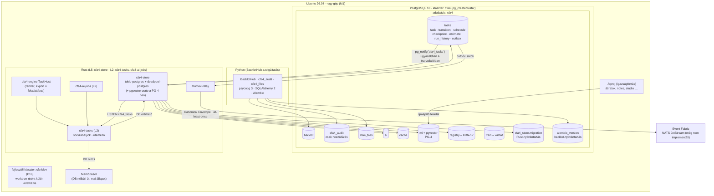

# CFA4 PostgreSQL- és pgvector-adatréteg: egyesített terv (CFA4-DATA-PG-001, VÉGLEGES 1.0)

> **Állapot:** VÉGLEGES 1.0, jóváhagyta István 2026-11-15 (22:09 CET). Kódolási engedélyt továbbra sem ad: minden fázis külön engedélyt igényel (coordination.md §2.10, 73–85. sor).
> **Dátum:** 2026-11-15 · **Döntések:** István, 2026-11-15 (P1–P17; D-1…D-8 és D-14 az ajánlás szerint) · **Szerző:** Horváth H. István (tulajdonos), Grok Bot
> **Repóállapot (git fetch 2026-11-15 ~21:55 CET):**
> - CFA4 main: `ce8057bb53fdee862a91633608af58d97a5a71c4` (2026-11-15 20:59 CET, #1385). A legutóbbi jelentés óta nem változott, adatbázist érintő változás nincs benne.
> - CFA4-AI_modules main: `fc8b7335033e3717e1793b9e3537ee19704b6e6c` (2026-11-12 07:50 CET, #49). Nem változott.
> - Nyitott, a tervet érintő PR-ek: AI_modules #50 (fej `66d1173`) és #52 (fej `16d1abfa`).
>
> **Hivatalos alapok, ezekre épül:**
> - CFA4 `docs/adr/ADR-0006-backlothub-postgresql.md` (2026-11-02), a 2026-11-07-i kiegészítéssel (56–63) és a 2026-11-11-i G2-kiegészítéssel (65–85);
> - CFA4 `docs/plans/CFA4-TASKSTORE-PG-001.md`: elfogadva 2026-11-07 (3. sor), a CFA4-példány a hiteles (216–217);
> - CFA4 `docs/adr/ADR-0008-cfa4-audit.md` (2026-11-08);
> - CFA4 `docs/adr/ADR-0009-cfa4-file-services.md` (2026-11-08);
> - AI_modules `docs/adr/ADR-0008-ai-processing-layer.md`;
> - CFA4 `docs/plans/CFA4-EVENT-FABRIC-001-1.0.md` és `…-CFA4-ILLESZTES.md` (Q9, Q10: 47–48).
>
> **Nem alap (CFA3/FA3):** a Final-Architecture-v3.0 és a CFA3 pgvector-találatait (pl. `FA3-DONOR-ODBC-SQL-VECTOR-MEDIA-2026-09-29.json`) csak jelzem, jóváhagyásnak nem tekintem. Az OxiMedia nem része a tervnek.

---

## 1. Cél, hatókör, nem-célok, kiindulási állapot

### 1.1 Cél

Egyetlen helyi PostgreSQL-klaszter (`cfa4`) szolgálja ki ezeket, modulonként saját sémával és szereppel:
- a BacklotHubot;
- a közös auditnaplót;
- a fájlkatalógust;
- a közös tartós feladatsort (a render is ennek egy feladattípusa);
- az AI-jobtárat;
- a gyorsítótár-indexet;
- a Media Intelligence indexét (pgvector);
- a KDN-17 nyilvántartást.

Második adatbázismotor nincs (TASKSTORE 31–33; ADR-0006 61. sor; AI ADR-0008 197–205, 335–336). A szerkesztő adatbázis nélkül is teljes értékű marad (P12, P14; TASKSTORE 47–51, 149–157).

### 1.2 Hatókör

- Klaszter, szerepkörök, sémák, migrációk, telepítés és üzemeltetés, mentés, megbízhatóság, biztonság, tesztek és CI.
- A tasks/ai/cache/mi/KDN-17 sémák részletesen; a backlot, cfa4_audit és cfa4_files sémák a saját ADR-jeikre hivatkozva; a train séma vázlatként.
- A fejlesztési sorrend: előbb az AI_modules, utána átvétel a CFA4-be (P13).

### 1.3 Nem-célok

- Képkockák, maszkok, médiafájlok és modellsúlyok tárolása adatbázisban. Ezek tartalomcímzett fájlok maradnak (TASKSTORE 38–40).
- Eseménytörténet: az a JetStreamé (TASKSTORE 39; EF 811). Átmeneti állapot: az a Valkeyé (EF 200–205).
- A projektfájl kiváltása: a `.fcproj` marad az igazságforrás (P8; architecture.md 216).
- M2/M3 (hálózati, több gépes) üzem: a séma kész rá (ADR-0006 32–34), de a telepítése nem ennek a tervnek a része.
- OxiMedia, CFA3/FA3-elemek.
- A BacklotHub üzleti sémáinak részletei: ezek a BacklotHub saját tervéhez tartoznak, a CFA4-BACKLOTHUB-001 szövege [nyitott].

### 1.4 Kiindulási állapot (tények)

| Terület | Állapot | Forrás |
|---|---|---|
| CFA4 main kód | Nincs adatbázis-crate. Az exportsor munkamenet-állapot, memóriában. | architecture.md 765–770; ADR-0006 19. sor |
| CFA4 main Qt Task Manager panel | `tasks.list`/`tasks.decide` parancsot hív, a CFA4 motorja ilyet nem ad; a panel ezt írja ki: „Not reported by this engine yet.” | python/cfa4_qt/panels/tasks.py 10, 16, 290, 320 (bea5b0e8) |
| AI_modules `cfa4-store` | Megvan: tokio-postgres 0.7.18 + deadpool-postgres 0.14.2, migrációs nyilvántartás, `tasks` séma v1–v2 | crates/store/Cargo.toml 17–18; src/migrate.rs 20–76 |
| `tasks` séma a kódban | Csak `task`, `transition`, `outbox`. A TASKSTORE `schedule`, `checkpoint`, `estimate`, `run_history` táblái hiányoznak. | migrate.rs 27–62 vs. TASKSTORE 62–68 |
| Azonosítók és idők a kódban | `id text` (1–256 karakter), az idő `bigint` UTC ms; csak az `updated_at`/`created_at`/`published_at` `timestamptz` | migrate.rs 28–38, 48, 59–60; crates/tasks/src/queue.rs 37 |
| Kimenőtár-esemény | `{taskId, seq, from, to, at, version}`, subject `cfa4.execution.job.{event,<állapot>}`. Nincs benne Canonical Envelope és UUID `event_id`. | crates/store/src/tasks.rs 121, 141–142; EF 313–329, 365, 778–785 |
| Kapcsolat | Alapértelmezés: `/var/run/postgresql`, port 5432, user és adatbázis `cfa4`, NoTls | lib.rs 31, 56–59 |
| INSTALL_HINT | A rendszer alapklaszterében hoz létre szerepet és adatbázist (`createuser cfa4`, `createdb -O cfa4 cfa4`) | lib.rs 84 |
| Rétegindok a kódban | L5, „which the L0–L4 WASM check cannot build” | lib.rs 19–20; acs-adaptiv-eroforras.md 188–191 |
| Bekötés | A store-t csak az AI-workerekkel kötik be az alkalmazásba. A vágás, a lejátszás és a mentés nem függhet az adatbázistól. | AI #49 leírása; osszevetes 66–67; acs 214–220 |
| CI az AI_modules-ban | A Rust workspace és az architecture gates `skipped` a #45, #49, #50, #52 fejénél és a 62e6236 és fc8b733 merge commitoknál. A store-t a CI soha nem fordította le. | check-runek (2. kör jelentése) |
| Tesztklaszter | `initdb` + `pg_ctl` ideiglenes könyvtárban; ha a gépen nincs PostgreSQL, a tesztek kimaradnak | crates/store/src/testdb.rs 1–4, 20–28 |
| Ubuntu 26.04 csomagok | `postgresql` 18+290ubuntu1 (PostgreSQL 18), `postgresql-18-pgvector` 0.8.1-2 | packages.ubuntu.com/resolute (lekérve 2026-11-15) |
| Store-tesztek eddig | PostgreSQL 16-on, helyben | AI #45 és #52 leírása |

---

## 2. Követelmények

| # | Követelmény | Forrás |
|---|---|---|
| R1 | **Offline-first:** M1-ben semmi nem igényel hálózatot | ADR-0006 43–44 |
| R2 | **Az adat nem hagyja el a gépet.** Az index soha nem kerül ki; felhő csak kifejezett beállítással (fájlmentésnél). | TASKSTORE 117–119; ADR-0009 41 |
| R3 | **Működés adatbázis nélkül:** a vágás, a lejátszás és a mentés soha nem függ az adatbázistól. DB nélkül a mai memóriasor fut, az AI-funkciók érthető üzenettel kikapcsolnak. | P12, P14; TASKSTORE 47–51, 155; lib.rs 8–10 |
| R4 | **Never crash:** minden hiba érték, angol hibakóddal (`DB_SERVER_MISSING` stb.) | AGENTS.md §0; ADR-0006 75–76; lib.rs 67–81 |
| R5 | **Kétszeri indítás kizárva:** az indítás egy tranzakció, `FOR UPDATE SKIP LOCKED`, bérlet, verziószám | TASKSTORE 127–138; EF Q10 (ILLESZTES 48) |
| R6 | **Idempotens fogyasztás:** a dedup kulcsa `consumer_id + event_id`, a tartós dedup-állapot az üzleti komponens saját tárában | EF §9 (585. sor); ILLESZTES Q9/Q10 (47–48) |
| R7 | **Élő DB:** RPO ≤ 5 s, RTO ≤ 1 perc. **Napi külső mentés:** RPO 24 óra, RTO 30 perc. A származtatott indexek (mi, cache) újraépíthetők. | P9; ADR-0006 45–48 |
| R8 | **16 GB-os minimumgép:** a PostgreSQL saját RAM-ja az ACS-keretbe számít. Profilok: 16 GB (minimum) és 32 GB (ajánlott). | TASKSTORE 159–165; AI #32; ADR-0006 94–95 |
| R9 | **Arcbeágyazás csak kifejezett, projektenkénti bekapcsolással.** Alapból ki van kapcsolva, egy lépésben törölhető. | TASKSTORE 120–123 |
| R10 | **Egy migrációs út minden módban, egy lépés visszafelé**, valós méretű adaton tesztelve | ADR-0006 96–97; TASKSTORE 179 |
| R11 | **Licenc:** GPL-3.0-or-later-kompatibilis (deny.toml engedélylista: MIT, Apache-2.0, Unlicense stb.) | ADR-0006 53–54; deny.toml 16–34 |
| R12 | **A média-idő `Tick` marad.** A `timestamptz` csak a falióra-időre vonatkozik. | P5; TASKSTORE 95; transcripts.md 10–13 |

---

## 3. Egyesített architektúra

**Rétegek és felelősség:**

| Elem | Réteg / nyelv | Felelősség | Forrás |
|---|---|---|---|
| `cfa4-store` | L5, Rust | Kapcsolatkészlet, Rust-oldali migrációk, típusos lekérdezések. Más Rust-crate közvetlenül nem éri el az adatbázist. | P4; TASKSTORE 171–173 |
| `cfa4-tasks` | L2, Rust | Sorszabályok tár nélkül; minden tárra kötelezők | acs 150–156; AI ADR-0008 64 |
| `cfa4-ai-jobs` | L2, Rust | A `cfa4-tasks` kliense | AI ADR-0008 217–219 (crate-tábla) |
| BacklotHub, `cfa4_audit`, `cfa4_files` | Python | psycopg 3, SQLAlchemy 2, Alembic a `backlot` sémára | ADR-0006 77–85; ADR-0009 30–32 |
| `cfa4-audit` (Rust) | Rust | Közös tesztvektorok a Python-könyvtárral | ADR-0008 (audit) 34–36 |
| Outbox-relay | Rust | `tasks.outbox` → JetStream, at-least-once | TASKSTORE 68; AI #52 (outbox.rs) |
| `LISTEN`/`NOTIFY` | – | Ütemező-ébresztés: `Wake::Changed/Timeout/Lost` | TASKSTORE 144–145; AI #52 (listen.rs) |

**Tranzakciós invariáns:** az állapotváltás, a naplósor, a kimenő esemény és a `pg_notify` egy tranzakcióban íródik (lib.rs 13–17; AI #52). Az üzleti változás és az auditesemény szintén egy tranzakcióban, ezért a `backlot` és a `cfa4_audit` egy adatbázisban van (ADR-0006 73–75; audit ADR 22–24).

---

## 4. Sémák és szerepkörök

### 4.1 Szerepmodell

Tény: modulonként saját séma és szerep (ADR-0006 72–73; TASKSTORE 31–33). Az audit sémáját külön tulajdonosi szerep birtokolja, az alkalmazás szerepe csak `INSERT` és `SELECT` jogot kap (audit ADR 25–26).

Szerepek (minden szerep `NOLOGIN`, kivéve a bejelentkezőt):

| Szerep | Típus | Jogok |
|---|---|---|
| `cfa4_owner_<séma>` | NOLOGIN, a séma tulajdonosa | DDL a saját sémájában; migráció |
| `cfa4_app_<séma>` | NOLOGIN | DML a saját sémájában; `cfa4_audit`-ban csak INSERT/SELECT |
| `cfa4_login` (név: a D-1 szerint) | LOGIN, peer | Tagja a `cfa4_app_*` szerepeknek. Migrációnál `SET ROLE cfa4_owner_*` (lásd D-6). |

> **Döntés – D-1 (István, 2026-11-15, az ajánlás szerint): peer-azonosítás és szerepnév.** A `peer` módszer a kliens OS-felhasználónevét használja adatbázis-felhasználónévként, opcionális leképezéssel (postgresql.org/docs/18/auth-peer.html). A `cfa4-store` alapértelmezett felhasználója `cfa4` (lib.rs 58), az asztali felhasználó viszont pl. `istvan`. M1-ben „egy felhasználó vagy egy kis csapat ugyanazon a gépen” is lehet (ADR-0006 12).
> **Döntés:** a beállító lépés `pg_ident.conf`-leképezést ír (`cfa4map`: OS-felhasználó → `cfa4_login`), és felhasználónként felveszi a tagságot. A `StoreConfig.user` a leképezett szerepnév legyen. Az audit `actor_kind = os_user` így is az OS-uid-ot rögzíti (audit ADR 29–30).

### 4.2 Sématérkép

| Séma | Gazda (migrációs eszköz) | Fázis | Tartalom | Forrás |
|---|---|---|---|---|
| `backlot` | BacklotHub (Alembic) | BacklotHub-lépcsők | Produkciókezelő. A részletek [nyitott]: a CFA4-BACKLOTHUB-001 szövege nincs meg. | ADR-0006 84–85 |
| `cfa4_audit` | `cfa4_audit` / `cfa4-audit` (AU-1) | AU-1…AU-4 | Csak hozzáfűzhető, hash-láncolt; a személyes adat külön, nem láncolt táblában | audit ADR 20–33, 45–54 |
| `cfa4_files` | `cfa4_files` (Python) | FS-fázisok | Katalógus: UUIDv7, gyökérfüggetlen út, BLAKE3 | ADR-0009 22–34 |
| `tasks` | `cfa4-store` (Rust) | PG-2 | A közös tartós sor; a render is feladattípus (P14) | TASKSTORE 62–68 |
| `ai` | `cfa4-store` | PG-3 | AI-jobok, licencelfogadás, modellrekordok | TASKSTORE 69–71 |
| `cache` | `cfa4-store` | PG-3 | Tartalomcímzett gyorsítótár-index | TASKSTORE 72 |
| `mi` | `cfa4-store` | PG-4 | Media Intelligence + pgvector | TASKSTORE 80–125; P1, P2, P10 |
| `registry` (KDN-17, név javaslat) | `cfa4-store` | PG-K (lásd §9) | Sorozat, epizód, proxy- és modellnyilvántartás | P7; Kdenlive 287, 321–323 |
| `train` | `cfa4-store` | vázlat | Képzési rekordok; a súly a fájlrendszeren marad | TASKSTORE 218–220; AI #33 |
| `cfa4_store` | `cfa4-store` | PG-1 | Migrációs nyilvántartás (`migration`) | migrate.rs 78–84 (a sématérképből eddig hiányzott) |

### 4.3 `tasks` séma (P5 szerint igazítva)

A meglévő kódhoz képest a változások:
- minden azonosító `uuid` (v7, kliensoldalon generálva; ADR-0006 43–44);
- minden falióra-idő `timestamptz`;
- a TASKSTORE §3 hiányzó táblái pótolva.

| Tábla | Kulcsmezők (javaslat) | Megjegyzés / forrás |
|---|---|---|
| `tasks.task` | `id uuid PK`, `kind text` (render, export, ai-video, ai-audio, index, model-load, proxy, transcode), `module`, `project_ref`, `state`, `class_rank smallint` (P0, R, P1, P2), `priority smallint`, `submitted_at timestamptz`, `start_at timestamptz`, `lease_owner text`, `lease_until timestamptz`, `attempt int`, `version bigint`, `doc jsonb`, `labels` | TASKSTORE 62. Az R a P1 előtt áll: tulajdonosi döntés 2026-11-13 (AI #50; osszevetes 115). A labels az AI #52-ből. |
| `tasks.schedule` | `task_id uuid FK`, `mode` (now, resource, at, at+resource), `start_utc timestamptz`, `time_zone text` (IANA), `if_missed` (delay, next_slot, ask) | TASKSTORE 63. A #52 most `jsonb`-ben tárolja a `time_zone`-t. Az ajánlás: saját oszlop. |
| `tasks.transition` | `(task_id, seq) PK`, `from_state`, `to_state`, `at timestamptz`, `by_actor`, `reason` | TASKSTORE 64; migrate.rs 43–52 |
| `tasks.checkpoint` | `(task_id, stage) PK`, `cache_key`, `at timestamptz` | TASKSTORE 65 |
| `tasks.estimate` | `task_id`, `min_s`, `max_s`, `confidence`, `basis` | TASKSTORE 66; osszevetes 30 |
| `tasks.run_history` | `task_id`, implementáció, út, hardver-ujjlenyomat, bemenetméret, időtartam, csúcs-RAM és -VRAM | TASKSTORE 67 |
| `tasks.outbox` | `id bigserial PK` (sorrend), `event_id uuid UNIQUE` (v7), `task_id uuid`, `subject text`, `envelope jsonb`, `created_at timestamptz`, `published_at timestamptz` | TASKSTORE 68; migrate.rs 54–62; lásd D-3 |

> **Döntés – D-3 (István, 2026-11-15, az ajánlás szerint): kimenőtár és Event Fabric.** A kód eseménye nem Canonical Envelope, a subject-nevek eltérnek, a dedup pedig a `bigserial` azonosítóra épül (tasks.rs 121, 141–142). Az EF ezzel szemben kötelező mezőket vár (event_id UUID, event_type, event_version, occurred_at, producer, correlation_id, causation_id, schema_id, classification …: EF 313–329), az `event_id` ismétléskor sem változik (365), a subjectek pedig `cfa4.execution.job.created/started/progress/completed/failed/cancelled` (778–785).
> **Döntés:**
> 1. A kimenőtár sora a teljes envelope-ot tárolja, `event_id` = UUIDv7 (P5).
> 2. A subject az EF §13.4 szerinti. A belső állapotokat (queued, succeeded, cancelling …) leképezési tábla rendeli a hat EF-eseményhez, a részletes állapot a payloadba kerül.
> 3. Entitásonkénti sorszám a payloadban (Q10).
> 4. A relay-dedup marad a `bigserial`-en, a fogyasztói dedup az `event_id`-n.

> **Döntés – D-5 (István, 2026-11-15, az ajánlás szerint): a meglévő `text`/ms oszlopok átállítása.** A store nincs bekötve az alkalmazásba (AI #49), így felhasználói adat nincs.
> **Döntés:** új, harmadik migrációs lépés (`text` → `uuid`, `bigint` ms → `timestamptz`, visszafelé lépéssel), nem a v1 átírása. Így a „egy lépés vissza” szabály és a nyilvántartás következetes marad (migrate.rs 1–5). A `cfa4_tasks::UtcMs` (queue.rs 37) belső típus maradhat; a konverzió a store határán történik.

### 4.4 `ai` és `cache` séma (PG-3)

A tartalom a TASKSTORE 69–72 szerint:
- `ai.job` (képesség, implementáció, `route_decision`, az Előnézet és az Alkalmazás projektverziója);
- `ai.license_acceptance` (implementáció, súlyhash, projekt, idő, figyelmeztetés);
- `ai.model` és `ai.model_use` (SHA-256, család, revízió, változat, formátum, forrás, négy licencrész, út, állapot);
- `cache.entry` (kulcs, fájl, méret, LRU-idő, szint).

Mind `uuid` és `timestamptz`.

> **Döntés – D-7 (István, 2026-11-15, az ajánlás szerint): egy modellnyilvántartás.** A Kdenlive KDN-17 „modellek” és a KDN-18 „bejegyzés a KDN-17-be” (Kdenlive 287, 324–326) átfed az `ai.model`-lel (TASKSTORE 71) és az AI ADR-0008 közös modelltárával (64. sor). A transcripts.md a modellsúlyokat `<data dir>/models/<id>/`-ban tartja, SHA-256-tal rögzítve (67–69).
> **Döntés:** egyetlen modellnyilvántartás legyen, az `ai.model`. A KDN-18 oda ír; a KDN-17 `registry` sémája csak hivatkozik rá. A fájlok helye külön döntés: [nyitott].

### 4.5 `mi` séma: Media Intelligence és pgvector (PG-4, részletesen)

**Alap:** TASKSTORE §4 (80–125), P1, P8, P10. A CFA4-MEDIA-INTELLIGENCE-001 FINAL 2.0 szövege [nyitott]: „nincs a tárolókban” (AI-MODEL-TRAINING-001 22. sor). Az ACS-specifikáció is [nyitott] (OSSZEVETES 8–9); belőle csak az OSSZEVETES 110. sorban idézett §10 és §7.3 ismert.

**Cél:** szöveges és képes keresés jelenetre, felvételre, elhangzott mondatra, címkére; a találat egy klip adott szakaszára mutat (TASKSTORE 82–86). Ma a Media Intelligence keresés hiányzó funkció (docs/gaps.md 234), és a `transcript.search` kifejezés-egyezéssel keres a `.fcproj`-ban (transcripts.md 29).

**Táblák (az oszlopok javaslatok, a TASKSTORE 92–99 szerkezetére építve):**

| Tábla | Mezők | Kulcs és indexek |
|---|---|---|
| `mi.asset` | `id uuid`, `content_hash bytea` + `hash_alg text` (az azonosító a hash, nem az út), `last_path text`, `duration_ticks bigint`, `index_state text`, `updated_at timestamptz` | `UNIQUE(hash_alg, content_hash)` |
| `mi.project_link` (új) | `asset_id`, `project_path text`, `project_id uuid` [nyitott: van-e a `.fcproj`-nak stabil azonosítója], `media_item_ref text`, `seen_at timestamptz` | Ebből tudja az újraépítés, melyik projektfájlt kell olvasni. TASKSTORE 94: „a projektkapcsolatok”. |
| `mi.segment` | `id uuid`, `asset_id`, `start_tick bigint`, `end_tick bigint`, `kind` (shot, scene, speech, silence, music) | `CHECK (start_tick < end_tick)`; index `(asset_id, start_tick)`. Tick, egész szám (TASKSTORE 95; P5). |
| `mi.transcript` | `segment_id`, `text`, `lang text` (BCP 47), `speaker int` + `speaker_name`, `confidence real`, `source_rev text` (a `.fcproj` mentésazonosítója vagy hash-e), `tsv tsvector` (generált) | GIN-index a `tsv`-n, `simple` konfiggal (TASKSTORE 101–104). **Származtatott** (P8). |
| `mi.tag` | `segment_id`, `label`, `confidence`, `implementation`, `model_id` (→ `ai.model`) | index `(label)` |
| `mi.embedding_model` | `id uuid`, `implementation`, `weight_sha256` (→ `ai.model`), `dims int`, `metric` (cosine, l2, ip), `storage` (`vector` vagy `halfvec`), `modality` (image, text, audio), `index_name text`, `state` | P10; TASKSTORE 98 |
| `mi.embedding` | `segment_id`, `model_id`, `v vector NULL`, `h halfvec NULL`, `CHECK (num_nonnulls(v, h) = 1)` | PK `(segment_id, model_id)`; modellenként részleges HNSW (lásd lent) |
| `mi.face_consent` (új) | `project_ref`, `enabled bool`, `enabled_at`, `enabled_by` | Arcbeágyazás csak `enabled = true` mellett (TASKSTORE 120–121) |

**Indexek.**
- Modellenként egy részleges HNSW, a modell dimenziójára kasztolva. Például: `CREATE INDEX … USING hnsw ((h::halfvec(<dims>)) halfvec_cosine_ops) WHERE model_id = '<uuid>'` (TASKSTORE 101–102).
- A pgvector 0.8.1 HNSW-korlátja: `vector` legfeljebb 2000, `halfvec` legfeljebb 4000 dimenzió (pgvector v0.8.1 README 250–251). Ez dönti el modellenként, hogy `vector` vagy `halfvec` kell (P10).
- Szűréssel együtt az iteratív index-scan (0.8.0-tól, README 452–455, 470–474) adja a teljes találatszámot. Az `ef_search` értéke [nyitott], méréssel dől el.
- Teljes szöveges keresés: `tsvector` + GIN, `simple` konfiggal.

**Modellcsere (P10, TASKSTORE 108–110).**
1. Új modell = új `embedding_model` sor + új részleges index.
2. A régi vektorok a régi indexszel kereshetők maradnak, amíg a felhasználó nem törli őket.
3. Egy keresés mindig egyetlen `model_id`-re szűr; különböző modellek vektorai soha nem keverednek.
4. Az első modellt az AI-F4 kapunál mérés dönti el; addig a dimenzió, a metrika és a tárolási típus [nyitott].

> **Döntés – D-6 (István, 2026-11-15, az ajánlás szerint): modellenkénti DDL futásidőben.** Az új modellhez indexet kell építeni (`CREATE INDEX`), ehhez a séma tulajdonosi jogai kellenek. Az alkalmazásszerep (4.1) erre nem jogosult.
> **Döntés:** az indexépítés `tasks` feladat (`kind = index`, P2 osztály), és a `cfa4-store` `SET ROLE cfa4_owner_mi`-vel futtatja. A `mi` tisztán származtatott adat (P9), ezért ez a jogkiterjesztés csak erre a sémára vonatkozzon, az audit- és a backlot-sémára ne.

**Újraépítés a `.fcproj`-ból (P8, P9).**
- Forrás: `Project::transcripts`, médiaelemenként, szavak Tick-határral, beszélővel, megbízhatósággal, nyelvvel (transcripts.md 10–13). A szekvencia-átirat mindig származtatott, soha nem tárolódik (14–17); az MI-index sem tárolja.
- Az újraépítés menete: a `mi.project_link` alapján indul, projektenként egy `tasks` feladat (P2 osztály, szakaszonkénti ellenőrzőponttal; TASKSTORE 111–113).
  1. Beolvassa a `.fcproj`-t.
  2. A médiaelemet tartalomhash alapján megfelelteti a `mi.asset` sorral.
  3. A projektre vonatkozó `mi.transcript` sorokat egy tranzakcióban lecseréli, és beírja a `source_rev`-et.
- Idempotens: azonos `source_rev`-nél nincs írás.
- A vektorok újraépítéséhez újra kell futtatni a beágyazó modellt. Ennek ideje a gépen [nyitott], ezért a vektorok újraépítése nem része a 30 perces RTO-nak (lásd D-14).
- Ha a `.fcproj` és az index eltér, mindig a `.fcproj` nyer.

**Erőforrás.** A HNSW-építés memóriáját (`maintenance_work_mem`) és a kötegméretet az ACS-keret szabja meg, a 16 GB-os gépen is. Az indexépítés a többi feladattal együtt ütemeződik (TASKSTORE 114–116). A pgvector README szerint a gyors építéshez a gráfnak bele kell férnie a `maintenance_work_mem`-be, de az értéket nem szabad úgy beállítani, hogy kimerítse a memóriát (289–303). A konkrét értékek [nyitott], méréssel dőlnek el (§5.5).

**Törlés.** Ha egy asset kikerül minden projektből, egy lépésben törölhető minden hozzá tartozó szakasz, átirat, címke és vektor (TASKSTORE 117–119). Az arcbeágyazás projektenként egy lépésben törölhető (120–121).

**Hiányzó pgvector.** A vektoros keresés kezelhető hibát ad, az átiratkeresés és minden más működik (TASKSTORE 88–90). DB nélkül a meglévő `.fcproj`-alapú `transcript.search` szolgál (transcripts.md 29).

### 4.6 `registry` séma: a KDN-17 PostgreSQL-ben (P7)

Kiinduló tények:
- A KDN-17 tartalma: sorozatok, epizódok, feliratsablonok, presetek, proxyk, modellek; P2 prioritás, 30–50 óra, előfeltétele az ADR F8 3. lépése (Kdenlive 287).
- Az eredeti terv szerint `rusqlite`, a `.fcproj` marad az igazság, az adatbázis újraépíthető (321–323). Tulajdonosi döntés: „kell” (630).
- Az ADR-0006 a KDN-17-et nem érintette (49–50).
- P7: a KDN-17 PostgreSQL-be kerül, saját sémába; ami adatbázis nélkül is kell, az projektfájlba vagy atomi JSON-ba.

> **Döntés – D-8 (István, 2026-11-15, az ajánlás szerint): a KDN-17 tételeinek felosztása.** **Döntés:**
> - **Atomi JSON a `<data dir>`-ben, DB nélkül is működik:** feliratsablonok és presetek. Ez az `export-presets.json` mintája (architecture.md 765).
> - **Projektfájl:** az epizód sorozat-hivatkozása, egy UUIDv7.
> - **PostgreSQL (`registry`):** sorozat- és epizódnyilvántartás, proxy-nyilvántartás; a modelleket a D-7 szerint az `ai.model` adja.
> - A KDN-17 „kész” feltétele (a sorozat új epizódja egy lépésben megkapja a sablont és a preseteket; Kdenlive 322–323) DB nélkül is teljesüljön a JSON-ból; DB-vel a nyilvántartásból.

### 4.7 `train` séma (vázlat)

A képzési feladat egy `tasks.task` sor; a súly és a checkpoint a fájlrendszeren marad, az adatbázisban csak hivatkozás és SHA-256 van (TASKSTORE 218–220; AI #33). A tervezet állapotú, implementáció nincs engedélyezve (AI #33 leírása). A táblák [nyitott] a CFA4-AI-MODEL-TRAINING-001 véglegesítéséig.

---

## 5. Telepítés és üzemeltetés

### 5.1 Csomagok (P11, P12)

- Ubuntu 26.04 saját csomagjai: `postgresql` → PostgreSQL 18, `postgresql-18-pgvector` 0.8.1-2 (packages.ubuntu.com/resolute, lekérve 2026-11-15). A P11 küszöbe a pgvector ≥ 0.7, mert a `halfvec` a 0.7.0-ban jelent meg (pgvector CHANGELOG 37–39); a 0.8.1 ezt teljesíti.
- A pontos verziót a referenciagépen rögzíteni kell: [nyitott].
- A `.deb` mindkét csomagot `Recommends`-ként adja (P12). Ez eltér az ADR-0006 37. sorától és a TASKSTORE 47–48. sorától („függőségként hozza”), ezért mindkét dokumentumot frissíteni kell (§12).
- AppImage, Flatpak és `tar.gz` esetén a rendszerre telepített PostgreSQL-t használja (ADR-0006 38–39). A Flatpak-sandbox hozzáférése a `/var/run/postgresql` sockethez [nyitott].

### 5.2 Klaszter és idempotens beállító lépés (P6, P12)

**A beállító lépés (javasolt parancsnév: `cfa4-db-setup`) műveletei:**
1. Ellenőrzi a `postgresql-common` és a PostgreSQL 18 meglétét. Ha hiányzik: `DB_SERVER_MISSING`, kilépés hiba nélkül (ADR-0006 75–76).
2. `pg_lsclusters`: ha a `cfa4` klaszter létezik, ezt a lépést kihagyja. Ha nem: `pg_createcluster 18 cfa4 --start-conf=auto`. Az alapklaszterhez soha nem nyúl (P12; ADR-0006 70–71).
3. `postgresql.conf` (a cfa4 klaszteré): `listen_addresses = ''`; a memória- és kapcsolatbeállítások a §5.5 szerint.
4. `pg_hba.conf`: csak `local … peer map=cfa4map`; `pg_ident.conf`: a D-1 szerinti leképezés.
5. Létrehozza a `cfa4` adatbázist és a szerepeket (4.1).
6. `CREATE EXTENSION IF NOT EXISTS vector` (PG-4-től). A pgvector 0.8.1 `vector.control` fájlja nem jelöli „trusted”-nek a bővítményt, ezért a létrehozásához superuser kell (postgresql.org/docs/18/sql-createextension.html). Emiatt ezt a beállító lépés végzi, nem az alkalmazás.
7. Minden lépés megismételhető; a második futás nem változtat semmit.

> **Döntés – D-2 (István, 2026-11-15, az ajánlás szerint): a klaszter portja és socketje.** A `pg_createcluster` alapból „a következő szabad portot 5432-től” adja (Ubuntu manpage, pg_createcluster(1)), és a Unix-socket fájlneve is a portot tartalmazza. A `cfa4-store` alapértelmezése a 5432 (lib.rs 57). Ha a gépen már van alapklaszter, a cfa4 klaszter jellemzően más portot kap.
> **Döntés:** a beállító lépés a kiosztott portot a `<config dir>/cfa4/db.toml`-ba írja, és a `StoreConfig` ezt olvassa. Fix port helyett felismerés.

> **Döntés – D-4 (István, 2026-11-15, az ajánlás szerint): ki futtatja a beállító lépést.** A `pg_createcluster` root vagy `postgres` jogot igényel.
> **Döntés:**
> - `.deb`: a `postinst` futtatja, ha a Recommends-csomagok jelen vannak; különben később kézzel.
> - Többi csomagforma: első indításkor a felület `pkexec`-kel ajánlja fel, beleegyezéssel.
> - Az INSTALL_HINT (lib.rs 84) szövege erre a parancsra mutasson, ne az alapklaszterbeli `createuser`/`createdb` parancsokra (P6).

### 5.3 Kapcsolat

- Csak Unix socket, `peer`, jelszó nincs tárolva (ADR-0006 71–72). A `NoTls` helyes, mert nincs TCP (lib.rs 31).
- Kapcsolatkészlet: kevés kapcsolat (alap 4, legfeljebb 64), 3 s időkorlát (lib.rs 48–62; TASKSTORE 163–164).

### 5.4 Indítás és szolgáltatás

A cfa4 klaszter a `postgresql@18-cfa4` systemd-egységként indul (`--start-conf=auto`). A felhasználói és a rendszerszolgáltatás közötti választás az ADR-0006 G2-ben eldőlt: rendszercsomag, külön klaszter (65–76). A felhasználónkénti indítás nem cél.

### 5.5 Erőforrás-keret (ACS)

- A PostgreSQL RAM-ja az ACS-keretbe számít, az erőforrás-kezelő levonja (TASKSTORE 161–162).
- Kiinduló értékek: kevés kapcsolat, kis `shared_buffers` (TASKSTORE 163–165). A `maintenance_work_mem` az indexépítő feladat foglalása legyen, ne globális beállítás: a feladat `SET LOCAL`-lal kéri, az ACS-foglalás után (TASKSTORE 114–116).
- A számértékek [nyitott]: mérés dönti el a `run-minspec.sh` 16 és 32 GB-os profilján (TASKSTORE 164–165; ADR-0006 94–95).

### 5.6 Mentés és visszaállítás (P9)

| Szint | Cél | Mód (javaslat) | Forrás |
|---|---|---|---|
| Élő DB | RPO ≤ 5 s, RTO ≤ 1 perc | WAL, `fsync=on`, `synchronous_commit=on`; összeomlás után a WAL-visszajátszás és a klaszter újraindítása | ADR-0006 45–47 |
| Napi külső mentés | RPO 24 óra, RTO 30 perc | Naponta `pg_dump -Fc` (vagy alapmentés + WAL-archívum) külső célra. A mód és a cél [nyitott] (ADR-0006 47–48 a BacklotHub NFR-jére bízza). | P9 |
| Fájlkatalógus | a PostgreSQL-mentés része | – | ADR-0009 41 |
| Származtatott (mi, cache) | újraépíthető | Visszaállítás után az újraépítő feladat fut | P9; §4.5 |

> **Döntés – D-14 (István, 2026-11-15, az ajánlás szerint): a mi és a cache benne van a napi mentésben.** A vektorok újraépítése modellfuttatást igényel, ideje [nyitott].
> **Döntés:** a mentésben benne vannak, ha a méret engedi (a méret [nyitott]). A 30 perces RTO a nem származtatott sémákra vonatkozik. A mi és a cache RTO-ja „újraépítésig”, és ez a felületen látszik.

### 5.7 Verziófrissítés

- Főverzió-váltás `pg_upgradecluster`-rel (postgresql-common), előtte kötelező napi mentéssel.
- A pgvector csomagnak a cél-főverzióhoz is meg kell lennie; utána `ALTER EXTENSION vector UPDATE`.
- A HNSW-indexek újraépítése szükség szerint, feladatként.
- Ubuntu-kiadásváltáskor a beállító lépés jelzi, ha a klaszter régebbi főverzión fut. A pontos eljárás és a próbája a PG-1 kilépési feltétele.

### 5.8 Kiesés kezelése

A TASKSTORE 149–157 szerint:
- új feladat nem indul;
- a futó feladat a szakaszhatárig fut, utána megáll;
- visszatérő kapcsolatnál a felügyelő pótolja a naplót a gyorsítótárból;
- nincs végtelen újrapróbálás.

DB nélkül a mai memóriasor fut (P14). Az átállás a két sor között induláskor dől el. Futás közben nincs átállás: ha a DB futás közben elvész, a sor „DB nem érhető el” állapotot jelez, és nem költözik át a memóriasorra, mert az kétszeri indítást okozhatna (R5).

---

## 6. Migrációk

- **Egy út minden módban, egy lépés vissza**, valós méretű adaton tesztelve (ADR-0006 96–97).
- **Sémagazdák:** minden sémának pontosan egy migrációs eszköze van.
  - Rust: `cfa4-store` beágyazott lépései, komponensenként, `cfa4_store.migration` nyilvántartással és tanácsadó zárral (migrate.rs 1–5, 78–87). A `tasks`, `ai`, `cache`, `mi`, `registry` és `train` sémát kezeli.
  - Python: Alembic, kizárólag a `backlot` sémára (ADR-0006 84–85). A `cfa4_audit` és a `cfa4_files` saját migrációja a saját könyvtárában (ADR-0006 85).
- **Együttélés:**
  1. Az eszközök egymás sémájához nem nyúlnak.
  2. Sémák közötti idegen kulcs nincs. A hivatkozás UUID, az épséget alkalmazásszintű ellenőrzés adja. Kivétel lehet a `backlot` → `cfa4_audit` irány, ha a BacklotHub terve kéri: [nyitott].
  3. Egy belépési pont, a `cfa4-db-setup migrate`, rögzített sorrendben futtat: audit → files → backlot → Rust-komponensek.
- **Visszalépés:** a `down` csak a legutolsó lépésre (migrate.rs 118–139). Az újabb CFA4 által alkalmazott lépést a régebbi nem bontja vissza, hanem hibát ad (131. sor).
- **Futtatási jog:** migráció csak tulajdonosi szereppel (`SET ROLE cfa4_owner_<séma>`), az alkalmazásszerep nem végezhet DDL-t (a D-6 kivételével).

---

## 7. Megbízhatóság

### 7.1 Invariánsok

| ID | Invariáns | Forrás |
|---|---|---|
| I1 | Egy feladat legfeljebb egyszer indul. Az indítás, a bérlet, a napló, a kimenő esemény és a notify egy tranzakció. | TASKSTORE 129–131; lib.rs 13–17 |
| I2 | Elavult állapotváltás nem írhat felül újabbat (verziószám) | TASKSTORE 135–136; tasks.rs 114 |
| I3 | Lejárt bérlet után a feladat soha nem indul elölről magától | TASKSTORE 132–134 |
| I4 | Auditköteles művelet nem hajtható végre, ha a napló nem írható | audit ADR 23–24, 59 |
| I5 | A `.fcproj` az igazság; a `mi.transcript` mindig újraépíthető belőle | P8 |
| I6 | Különböző beágyazó modellek vektorai nem keverednek | TASKSTORE 108–110 |
| I7 | A szerkesztő funkciói nem várnak az adatbázisra | TASKSTORE 155; P12 |
| I8 | A kimenő esemény `event_id`-je ismétléskor nem változik | EF 365 |
| I9 | A katalógus soha nem mutat félkész fájlra | ADR-0009 35–36 |

### 7.2 FMEA

| Hiba | Hatás | Észlelés | Kezelés | Teszt |
|---|---|---|---|---|
| A PostgreSQL nincs telepítve | Nincs sor és nincs AI | `connect` → `Unavailable` | `DB_SERVER_MISSING`, a beállító parancs megjelenítése; memóriasor | DB nélküli út teszt (P15) |
| A cfa4 klaszter le van állítva | Ugyanaz | `connect` időtúllépés (3 s) | Érthető hiba; nincs végtelen újrapróbálás | Szerver leállítása futás közben |
| Rossz port vagy socket (D-2) | Kapcsolódás sikertelen | `Unavailable` | `db.toml` újraolvasása, a beállító lépés ismétlése | Két klaszter egy gépen |
| A folyamat összeomlik az indítási tranzakció közben | – | – | A tranzakció visszagördül, a feladat nem indult | Leölés a tranzakció minden pontján (TASKSTORE 183–184) |
| Összeomlás a commit és a közzététel között | Az esemény késik | Megmarad a `published_at IS NULL` sor | A relay újraküldi (at-least-once), a fogyasztó dedupol | Összeomlási ablak (TASKSTORE 187–188; Q9) |
| Átrendezett kézbesítés | Régi `progress` írná felül a `completed`-et | Sorszám | Elavult elvetése | Q10-teszt |
| A worker meghal | A feladat beragad | Bérletlejárat | Folytatás ellenőrzőponttól, vagy `failed` | Bérletlejárat-teszt (TASKSTORE 185) |
| Teli lemez vagy WAL | Írás sikertelen | Hibakód | Kezelhető hiba, a feladat megáll; az audit fail-closed | Lemezkorlátos teszt |
| Kifogy a memória HNSW-építés közben | Az OOM a gépet fenyegeti | ACS-figyelés (PSI) | `maintenance_work_mem` az ACS-foglalás szerint; az építés megszakítható | 16 GB-os profil |
| Hiányzik a pgvector | Nincs vektoros keresés | `CREATE EXTENSION` vagy típushiba | Kezelhető hiba, az átiratkeresés működik | TASKSTORE 190 |
| Sérült sor | Dekódolási hiba | `StoreError::Corrupt` | Jelenti, nem bízik meg benne, nincs pánik | lib.rs 77–78; ellenséges `jsonb` (TASKSTORE 191–192) |
| Eltér az index és a `.fcproj` | Elavult keresési találat | `source_rev` | Újraépítő feladat | Újraépítési teszt |
| Párhuzamos migráció két CFA4-folyamatból | Sémaverseny | Tanácsadó zár | Sorba állít | migrate.rs 86–87 |
| Főverzió-váltás közben megszakad | A klaszter nem indul | `pg_lsclusters` | Visszaállítás napi mentésből (RTO 30 perc) | PG-1 próba |

---

## 8. Biztonság és adatvédelem

- **Hálózat:** M1-ben nincs TCP (`listen_addresses = ''`), csak `peer` (ADR-0006 71–72). Ezért az EF NATS-TLS-szabálya (EF 665, 693) itt nem értelmezett.
- **Jogok:** séma-tulajdonos és alkalmazásszerep külön (4.1). Az auditnapló csak hozzáfűzhető, triggerrel kikényszerítve (audit ADR 25–26).
- **Személyes adat:** a láncba nem kerül, külön táblába igen, és törölhető, `TOMBSTONE`-nal (audit ADR 32–33).
- **Biometrikus adat:** az arcbeágyazás projektenkénti, kifejezett bekapcsolással indexelhető (`mi.face_consent`), alapból ki van kapcsolva, és egy lépésben törölhető. Az arccserére a hozzájárulási nyilatkozat és a nem kikapcsolható jelölés vonatkozik (TASKSTORE 120–123; AI #34 6–9. pont).
- **Modellek:** a felhasználó tölti le őket, egyszeri licencelfogadással; a CFA4 nem terjeszt modellt (TASKSTORE 124–125).
- **Nyugalmi titkosítás:** kapcsolható (ADR-0006 47–48). Javaslat: fájlrendszer-szinten (LUKS vagy fscrypt), a File Services mintájára (ADR-0009 42). [nyitott]: a BacklotHub NFR-je rögzíti.
- **Az adat a gépen marad** (R2). A napi külső mentés célja a felhasználó választása; felhőbe csak kifejezett beállítással kerül (ADR-0009 41).
- **Ellenséges bemenet:** hibás `jsonb`, túlméretes mező, érvénytelen időzóna esetén hibát ad, pánikot nem (TASKSTORE 191–192; migrate.rs 28 hosszkorlát).

---

## 9. Fázisok és kapuk

**Sorrend (P2, P13):** PG-0 → PG-1 és PG-2 az AI_modules-ban → T (átvétel a CFA4-be, §2.8, külön döntéssel) → PG-3 (AI-F2) → PG-K (KDN-17) → PG-4 (AI-F4, a Qt 6 átállás és az egui eltávolítása után).

Megjegyzések:
- A PG-1 és a PG-2 egy része az ACS-4 keretében már elkészült az F0-időszakban (AI #45, #49). Ezt az ACS-1…ACS-4 F0-beli engedélye fedezte (AI #34; AI ADR-0008 351–356).
- Az `ai` séma a `cfa4-ai-jobs`-hoz tartozik, ez pedig AI-crate, ami az F0 előtt nem indulhat (AI ADR-0008 353). Ezért a PG-3 az AI-F2-höz kötött (381–383).

| Fázis | Hol | Belépés | Tartalom | Kilépés (mérhető kapu) |
|---|---|---|---|---|
| **PG-0** | docs | P1–P17 (2026-11-15) | Ez a terv; ADR-0006 kiegészítés; TASKSTORE-frissítés; #50-igazítás; P17 (§12) | Tulajdonosi jóváhagyás (megvan: István, 2026-11-15); a dokumentumok a CFA4 main `docs/plans/` és `docs/adr/` mappájában vannak (Kdenlive T4 670). A D-7 és a D-8 eldöntve (István, 2026-11-15, az ajánlás szerint), így a PG-K döntési belépési feltétele teljesül. |
| **PG-1** | AI_modules | PG-0 jóváhagyva | `cfa4-store`: rétegindok P4 szerint (lib.rs 19–20); szerepmodell; `db.toml` (D-2); INSTALL_HINT (P6); `cfa4-db-setup` (idempotens); hibakódok | (1) Migráció oda-vissza zöld, PostgreSQL 18 eldobható klaszteren, CI-ben, a fej-commiton, nem `skipped` (P15). (2) Hiányzó vagy leállt szerverre `Unavailable`, pánik nélkül. (3) A beállító lépés kétszer futtatva ugyanazt az állapotot adja. (4) `cargo xtask layers` zöld, a store L5. (5) DB nélküli út teszt zöld. |
| **PG-2** | AI_modules | PG-1 kész | `tasks`: UUIDv7/timestamptz-lépés (D-5); `schedule`, `checkpoint`, `estimate`, `run_history`; LISTEN/NOTIFY és relay (#52); envelope és subjectek (D-3); a render és az export feladattípus (P14) | A TASKSTORE 183–188 összes tesztje zöld CI-ben: leölés minden tranzakciós ponton → 0 kétszeres indítás; bérletlejárat; DB-újraindítás futó feladat közben; ütemezés (pontos, elmaradt, időzóna- és nyáriidő-váltás); összeomlási ablak; átrendezett kézbesítés. Mért RTO a klaszter újraindítása után ≤ 1 perc (P9). |
| **T – átvétel** | CFA4 | PG-1 és PG-2 kész; #50 és #52 a P4–P6 szerint javítva és beolvasztva (P13) | `cfa4-tasks`, `cfa4-store`, TaskHost, `tasks.*` a CFA4 főágba; a Qt-panel valós adatot kap | Külön tulajdonosi és gazdadöntés (coordination §2.8, 37–42). A CFA4 full-validation-gate minden blokkoló jobja ténylegesen lefutott és zöld a fejen (§3.4, 99–103), plusz a PostgreSQL-es CI-futás (P15). A DB nélküli út: vágás, lejátszás, mentés és memóriasor változatlan. |
| **PG-3** | CFA4 | AI-F0 kész (Qt 6 kész, egui kikerült; AI ADR-0008 351–353); T kész | `ai` és `cache` séma | CFA4-újraindítás után nincs elveszett vagy kétszer indult job; a licencelfogadás és minden jobállapot az adatbázisban van (TASKSTORE 203) |
| **PG-K** | CFA4 | ADR F8 3. lépés (Kdenlive 287); D-7 és D-8 eldöntve | `registry` séma; JSON-oldal | A KDN-17 „kész” feltétele DB-vel és DB nélkül is teljesül (§4.6) |
| **PG-4** | CFA4 | AI-F4 kapu; Qt 6 átállás és egui-eltávolítás kész (P2); PG-3 kész | `mi` séma, pgvector, `pgvector` crate; első beágyazó modell méréssel (P10); átiratindexelés (AI-F5, 406–407) | (1) Az első kép- és szövegbeágyazó kimenete indexelődik és kereshető (TASKSTORE 204). (2) A TASKSTORE 190 MI-tesztjei zöldek. (3) Az elvárt szakasz a legjobb k találat között van az ismert mintakészleten; k és a küszöb [nyitott]. (4) Az indexépítés RAM-ja az ACS-kereten belül marad a 16 GB-os profilon. (5) Az újraépítés a `.fcproj`-ból bitre azonos `mi.transcript` tartalmat ad. (6) A pgvector-tesztek CI-ben futnak (P15). |

---

## 10. Tesztek és CI

- **Valódi PostgreSQL a CI-ben (P15):** eldobható klaszter `initdb` + `pg_ctl`-lel (testdb.rs 1–4), PostgreSQL 18-cal, a referenciagéppel azonos főverzión (P11).
  - Ma ezek a jobok `skipped`-ek az AI_modules-ban (check-runek, 2. kör), ezért az átvétel feltétele, hogy a job ténylegesen lefusson.
  - A TASKSTORE 193–194 szerinti „kimarad, ha nincs PostgreSQL” viselkedés csak helyi fejlesztésre maradhat; CI-ben a PostgreSQL hiánya hiba.
- **`cargo xtask layers`** a store-ral együtt (P15).
- **DB nélküli út teszt:** a szerkesztő, a mentés és a memóriasor PostgreSQL nélkül; az AI-funkciók érthető üzenettel kikapcsolnak (P12, P15).
- **pgvector-tesztek** a PG-4-től (P15).
- **Tesztkészlet:** TASKSTORE 183–192, kiegészítve:
  - D-1 peer-leképezés;
  - D-2 két klaszter egy gépen;
  - beállító lépés idempotencia;
  - visszaállítás napi mentésből ≤ 30 perc referencia-adatméreten (az adatméret [nyitott]);
  - modellenkénti index építése és elkülönülése;
  - újraépítés a `.fcproj`-ból.
- **Fejlesztői adatbázis (P16):** külön fejlesztői klaszter (javasolt név `cfa4dev`), worktree-nként külön adatbázis, migráció csak a sajátra (CFA4-DEV-WORKTRUNK-001-1.1 55, 219, 246, 322). A felhasználói `cfa4` klasztert soha nem érinti. A klaszter és a portja a fejlesztői `db.toml`-ból jön.
- **ACS-stabilitás:** `scripts/dev/acs7-stability.sh` a referenciagépen, 16 és 32 GB-os profilon. Ez a tulajdonos teendője (osszevetes 69–70; AI #52).

---

## 11. Függőségek (felsorolás)

| Függőség | Verzió (forrás) | Licenc | Mikor |
|---|---|---|---|
| PostgreSQL (rendszercsomag) | 18 az Ubuntu 26.04-en (packages.ubuntu.com) | PostgreSQL License (ADR-0006 89) | PG-1 |
| postgresql-common (`pg_createcluster`, `pg_upgradecluster`) | 290ubuntu1 | [nyitott]: nem ellenőriztem | PG-1 |
| `postgresql-18-pgvector` | 0.8.1-2 | PostgreSQL License (pgvector LICENSE; TASKSTORE 88–89) | PG-4 |
| `tokio-postgres` | 0.7.18 (store Cargo.toml 17; crates.io) | MIT OR Apache-2.0 | megvan |
| `deadpool-postgres` | 0.14.2 (Cargo.toml 18; crates.io) | MIT OR Apache-2.0 | megvan |
| `postgres-types` | 0.2.14 (AI Cargo.lock) | MIT OR Apache-2.0 | megvan; `with-uuid-1` feature a P5-höz |
| `uuid` (v7 feature) | 1.26.1 a lockban; a crates.io legújabb 1.29.2 | Apache-2.0 OR MIT | PG-2 |
| `pgvector` crate (`postgres` feature; a `halfvec` feature a P10-hez) | 0.4.2 (crates.io, 2026-05-22), rust-version 1.60 | MIT OR Apache-2.0 | PG-4 |
| ↳ `bytes` (a `postgres` featuretől), `half` (a `halfvec` featuretől) | `half` 2.7.1 (mindkét lockban) | `half`: MIT OR Apache-2.0; `bytes`: [nyitott] | PG-4 |
| `jiff` (AI #52, `next_slot`) | 0.2.43 (#52); a crates.io legújabb 0.2.46 | Unlicense OR MIT (deny.toml 34 engedi) | PG-2 |
| `futures-util` | 0.3.34 (#52) | [nyitott]: nem ellenőriztem | PG-2 |
| psycopg 3 | – | LGPL-3.0-or-later (ADR-0006 78–79) | BacklotHub |
| SQLAlchemy 2, Alembic | – | MIT (ADR-0006 84) | BacklotHub |
| BLAKE3 | a G3 kapun rögzítve | CC0-1.0 / Apache-2.0 (ADR-0009 33–34) | File Services |

---

## 12. Dokumentációs teendők (PG-0)

1. **ADR-0006 – „Kiegészítés, 2026-11-15”:**
   - Rust-meghajtó: tokio-postgres + deadpool-postgres (P3). Ez lezárja a 80–83. sort.
   - `.deb`: `postgresql` és `postgresql-18-pgvector` Recommends (P12), a 37. sor helyett.
   - A cfa4 klasztert idempotens beállító lépés hozza létre (P12).
   - UUIDv7 + `timestamptz` minden modulra (P5).
   - A KDN-17 PostgreSQL-be kerül (P7); ez módosítja az 5. pontot (49–50).
   - RPO/RTO kétszintű (P9).
2. **TASKSTORE-PG-001 (CFA4, hiteles; P17, 216–217):**
   - §9: meghajtó (P3), L5 és a socketes OS-I/O indok (P4), a 176–178. sor helyett;
   - §3: `uuid`/`timestamptz` (P5); a `cfa4_store` séma felvétele;
   - §4: a `mi` részletei (§4.5), modellfüggetlenség (P10), a MI FINAL 2.0 [nyitott] (P1);
   - §7: memóriasor DB nélkül (P14); §8: klaszter (P6);
   - §10: valódi PostgreSQL-es CI (P15), fejlesztői klaszter (P16);
   - §11: a fázissorrend (P2, P13);
   - §12: a KDN-17 (P7), a render feladattípus és a RENDER-F0a §7 lezárása (P14).
   - Az AI_modules `docs/ai/postgresql-adatreteg.md` ehhez igazodik, vagy a CFA4-példányra mutat.
3. **AI_modules #50:** az L5-indok szövege a P4 szerinti legyen. Az ACS-terv 188–191 és a lib.rs 19–20 WASM-indoka cserélendő; a 197–200. sor „ms helyett timestamptz” eltérése a P5 szerint megszűnik.
4. **AI_modules #52:** igazítás a P4–P6 szerint (UUIDv7/timestamptz, klaszter, INSTALL_HINT), plusz a D-3 envelope.
5. **P17:**
   - a 137 soros `CFA4-ADAPTIVE-CAPABILITY-001-osszevetes.md` marad, a 189 soros `…-OSSZEVETES.md` beleolvad és törlődik;
   - a „kész” állításokat a beolvasztás állapotához kell igazítani (osszevetes 31, 48–51: az AI #50 és #52 még nyitott);
   - az OSSZEVETES 41. sorát (az ADR 0008 L5-ös rétege már javítva) és 23. sorát (a coordination.md hiánya) javítani kell, vagy a beolvasztáskor elhagyni.
6. **Kdenlive-terv:** a KDN-17 sora (287, 321–323) a P7 és a D-8 szerint; a D4/T7 (516, 673) elavult, mert az EF-terv a main-ben van (`docs/plans/CFA4-EVENT-FABRIC-001-1.0.md`).
7. **RENDER-F0a §7 (139):** lezárva, a render a `tasks` feladattípusa (P14).
8. **AI ADR-0008:** 216. sor L5 (#50); a 197–205 szövege az egy tartós sorral és a DB nélküli memóriasorral (P14).
9. **ADR-0009:32** („A Rust-motornak M1-ben nem kell PostgreSQL-kliens”): pontosítani, hogy ez a File Services-re vonatkozik. A motor a P13/P14 szerint a `cfa4-store`-on át kliens lesz.
10. **Elavult Gazda-issue-k** (#890, #916, #1276, #866, #772, #770, #768): a tartalmuk a main-ben van. A lezárásuk a gazda dolga, ez a terv nem nyúl hozzájuk.

---

## 13. Kockázatok

| Kockázat | Valószínűség / hatás | Kezelés |
|---|---|---|
| A store-t a CI eddig soha nem fordította le | Magas / magas | P15 az átvétel feltétele |
| PostgreSQL 16-on tesztelt kód, 18-as cél | Közepes / közepes | CI 18-cal (P11) |
| A peer-leképezés hibás (D-1) | Közepes / magas | A beállító lépés tesztje; érthető hiba |
| Port-ütközés az alapklaszterrel (D-2) | Magas / közepes | `db.toml`-felismerés |
| EF-envelope eltérés (D-3) | Biztos / közepes | PG-2 javítás; az EF még nem implementált (EF 1597) |
| A HNSW-építés RAM-ja a 16 GB-os gépen | Közepes / magas | ACS-foglalás, mérés |
| A kettős migrációs eszköz (Rust és Alembic) szétcsúszik | Közepes / közepes | Szigorú sémagazdaság, egy belépési pont |
| A KDN-17 felosztása (D-8) elhúzódik | Közepes / alacsony | A PG-K független a PG-4-től |
| A MI FINAL 2.0 később eltérő követelményt hoz | Ismeretlen / közepes | Modellfüggetlen `mi` séma (P10); a PG-4 kapuja előtt felülvizsgálat |
| A Flatpak-sandbox nem éri el a socketet | Ismeretlen / közepes | [nyitott]; DB nélküli út |
| Két összevetés-fájl kis- és nagybetűs ütközése | Biztos / alacsony | P17 |

---

## 14. Meghozott döntések

**István, 2026-11-15:**
- **P1** A pgvector-rész a TASKSTORE §4-re épül. A MEDIA-INTELLIGENCE-001 FINAL 2.0, az ACS-specifikáció és a BACKLOTHUB-001 [nyitott].
- **P2** A pgvector a PG-4-ben marad, az AI-F4 kapunál, a Qt 6 átállás és az egui-eltávolítás után; előtte PG-0…PG-3.
- **P3** tokio-postgres + deadpool-postgres, az ADR-0006-ban rögzítve, a TASKSTORE §9 igazodik. A PG-4-ben a `pgvector` crate (`postgres` feature): 0.4.2, MIT OR Apache-2.0 (crates.io, ellenőrizve).
- **P4** A `cfa4-store` L5, indok: socketes OS-I/O. Az AI #50 és a TASKSTORE igazodik.
- **P5** UUIDv7 + `timestamptz`; a média-idő Tick marad.
- **P6** Külön `cfa4` klaszter, csak Unix socket, `peer`. A kód és az INSTALL_HINT igazodik.
- **P7** A KDN-17 PostgreSQL-be kerül, saját sémába; a DB nélkül is szükséges rész projektfájlba vagy atomi JSON-ba.
- **P8** Az átiratok igazságforrása a `.fcproj`; a `mi.transcript` származtatott, újraépíthető.
- **P9** Élő DB: RPO ≤ 5 s, RTO ≤ 1 perc. Napi mentés: RPO 24 óra, RTO 30 perc. A mi és a cache újraépíthető.
- **P10** A `mi` séma modellfüggetlen; az első modellt az AI-F4 kapunál mérés dönti el.
- **P11** Ubuntu 26.04 csomagok, pgvector ≥ 0.7; a pontos verzió a referenciagépen rögzítve; a CI ugyanazzal a főverzióval fut.
- **P12** `.deb` Recommends; a szerkesztő nélkülük is fut; idempotens beállító lépés; az alapklaszterbe nem ír.
- **P13** Előbb az AI_modules (#50, #52 javítva), utána átvétel a §2.8 szerint; a mi séma és a pgvector a CFA4-ben, a PG-4-ben.
- **P14** Egy tartós sor a `tasks` sémában, a render feladattípus (a RENDER-F0a §7 lezárva); DB nélkül memóriasor.
- **P15** Az átvétel feltétele valódi PostgreSQL-es CI, `xtask layers`, és a DB nélküli út tesztje; pgvector-tesztek a PG-4-től.
- **P16** Worktree-nkénti fejlesztői adatbázis külön fejlesztői klaszterben.
- **P17** A 137 soros összevetés marad, a „kész” állítások javítva; a CFA4 TASKSTORE a hiteles.

**István, 2026-11-15 (22:09 CET), a D-pontok az ajánlás szerint:**
- **D-1** Peer-azonosítás `pg_ident.conf`-leképezéssel (`cfa4map`: OS-felhasználó → `cfa4_login`), felhasználónkénti tagság; a `StoreConfig.user` a leképezett szerepnév (§4.1).
- **D-2** A beállító lépés a kiosztott portot a `<config dir>/cfa4/db.toml`-ba írja, a `StoreConfig` ezt olvassa; fix port helyett felismerés (§5.2).
- **D-3** A kimenőtár a teljes Canonical Envelope-ot tárolja, `event_id` = UUIDv7; EF §13.4 szerinti subjectek leképezési táblával; entitásonkénti sorszám; relay-dedup `bigserial`-en, fogyasztói dedup `event_id`-n (§4.3).
- **D-4** A beállító lépést `.deb`-nél a `postinst` futtatja, a többi csomagformánál első indításkor a felület `pkexec`-kel ajánlja fel; az INSTALL_HINT erre a parancsra mutat (§5.2).
- **D-5** Új, harmadik migrációs lépés a `text` → `uuid` és `bigint` ms → `timestamptz` átállításhoz, visszafelé lépéssel; a v1 nem íródik át (§4.3).
- **D-6** A modellenkénti HNSW-indexépítés `tasks` feladat (P2 osztály), a `cfa4-store` `SET ROLE cfa4_owner_mi`-vel futtatja; a jogkiterjesztés csak a `mi` sémára vonatkozik (§4.5).
- **D-7** Egyetlen modellnyilvántartás, az `ai.model`; a KDN-18 oda ír, a KDN-17 `registry` csak hivatkozik rá (§4.4).
- **D-8** A KDN-17 felosztása: feliratsablonok és presetek atomi JSON-ban, az epizód sorozat-hivatkozása a projektfájlban, a sorozat-, epizód- és proxy-nyilvántartás a `registry` sémában (§4.6).
- **D-14** A mi és a cache benne van a napi mentésben, ha a méret engedi; a 30 perces RTO a nem származtatott sémákra vonatkozik, a mi és a cache RTO-ja „újraépítésig” (§5.6).

**Korábbi jóváhagyások:**
- ADR-0006: 2026-11-02 (3. sor); kiegészítések 2026-11-07 (56–63) és 2026-11-11 (65–85; BacklotHub #48, #49, #52).
- TASKSTORE-PG-001: 2026-11-07 (3. sor); közös klaszter a BacklotHubbal (45–46); PostgreSQL kell a sorhoz és az AI-hoz (47–51); a MI most kerül a tervbe (42–44).
- Audit ADR 0008: 2026-11-08. ADR-0009: 2026-11-08 (BacklotHub #43/#45/#14; #770).
- EF: Q9, Q10 2026-11-06 (ILLESZTES 47–48); az EF-terv jóváhagyva 2026-11-02 (EF 3–4).
- Meghajtó: 2026-11-11 (lib.rs 4–5; AI #45). Az ACS-1…4 mehet az F0-ban: 2026-11-07 (AI #34).
- Sorrend P0, R, P1, P2: 2026-11-13 (AI #50; osszevetes 115).
- Stáblistához nem kell adatbázis: 2026-11-14 (TITLE-CREDITS ILLESZTES 286).
- KDN-17 „kell”: Kdenlive 630. RAM-minimum 16 GB, ajánlott 32 GB: 2026-11-07 (AI #32).

---

## 15. Nyitott tételek

**[nyitott], a forrás nem elérhető:**
1. CFA4-MEDIA-INTELLIGENCE-001 FINAL 2.0 szövege (AI-MODEL-TRAINING-001 22).
2. CFA4-ADAPTIVE-CAPABILITY-001 (ACS) szövege (OSSZEVETES 8–9).
3. CFA4-BACKLOTHUB-001 és a BacklotHub #14–#56 issue-k: egyik repóban sincsenek.
4. Az AI ADR-0008 10–11. sorában hivatkozott claude.ai artifaktok: csak üres JS-vázat adnak.

**[nyitott], mérés vagy adat kell:**
5. A referenciagép pontos PostgreSQL- és pgvector-verziója (P11).
6. `shared_buffers`, `max_connections`, `maintenance_work_mem` értékei a 16 és a 32 GB-os profilon.
7. Az első beágyazó modell: dimenzió, metrika, `vector` vagy `halfvec` (P10).
8. A keresési minőség kapuja: k, küszöb, mintakészlet; `hnsw.ef_search`.
9. A mentés módja és célja; a referencia-adatméret a 30 perces RTO-hoz.
10. A vektor-újraépítés ideje.
11. Van-e a `.fcproj`-nak stabil projektazonosítója (`mi.project_link`).
12. Flatpak-sandbox és a socket elérése.
13. A `train` séma táblái.
14. A `postgresql-common`, a `bytes` és a `futures-util` licence: nem ellenőriztem.
15. A modellfájlok helye (`<data dir>/models` vagy a közös modelltár) a D-7 után.

---

## 16. Források

**CFA4 (`ce8057bb`):**
- `docs/adr/ADR-0006-backlothub-postgresql.md`, `ADR-0008-cfa4-audit.md`, `ADR-0009-cfa4-file-services.md`, `ADR-0014-cfa4-app-launcher.md` (29–30)
- `docs/plans/CFA4-TASKSTORE-PG-001.md`, `CFA4-EVENT-FABRIC-001-1.0.md`, `…-CFA4-ILLESZTES.md`, `CFA4-KDENLIVE-PLAN-001-FINAL-1.0.md`, `CFA4-ADAPTIVE-CAPABILITY-001-OSSZEVETES.md` és `…-osszevetes.md`, `CFA4-AI-MODEL-TRAINING-001.md`, `CFA4-TITLE-CREDITS-001-1.0-CFA4-ILLESZTES.md`
- `docs/audit/RENDER-F0a-BASELINE-2026-11-14.md` (126, 139)
- `docs/architecture.md`, `docs/coordination.md`, `docs/transcripts.md`, `docs/gaps.md`
- `docs/development/worktrunk/CFA4-DEV-WORKTRUNK-001-1.1.md`
- `python/cfa4_qt/panels/tasks.py`, `crates/format/src/lib.rs` (62–70), `deny.toml` (16–34)

**AI_modules (`fc8b7335`):**
- `docs/adr/ADR-0008-ai-processing-layer.md`, `docs/ai/acs-adaptiv-eroforras.md`, `docs/ai/postgresql-adatreteg.md`
- `crates/store/{Cargo.toml, src/lib.rs, src/migrate.rs, src/tasks.rs, src/testdb.rs}`, `crates/tasks/src/queue.rs`
- PR-ek: #31–#35, #40, #45, #49 (beolvasztva); #50 (`66d1173`) és #52 (`16d1abfa`), nyitva
- Check-runek: 06dcee1, aaf851d, 16d1abfa, 66d1173, 62e6236, fc8b733

**CFA4 PR-ek, issue-k, CI-futások:**
- PR #511, #710, #920; a gate-futások 41766679145, 41766726093, 42399268951, 42962050102
- Issue-k: #515, #768, #770, #772, #866, #867, #890, #916, #1276

**Külső források (lekérve 2026-11-15):**
- crates.io API: pgvector 0.4.2, tokio-postgres 0.7.18, deadpool-postgres 0.14.2, postgres-types 0.2.14, uuid, half, jiff
- packages.ubuntu.com/resolute: postgresql 18+290ubuntu1, postgresql-18-pgvector 0.8.1-2
- pgvector v0.8.1: README (250–251, 289–303, 446–474), CHANGELOG (37–39), vector.control, LICENSE
- manpages.ubuntu.com pg_createcluster(1)
- postgresql.org/docs/18: auth-peer.html, sql-createextension.html
