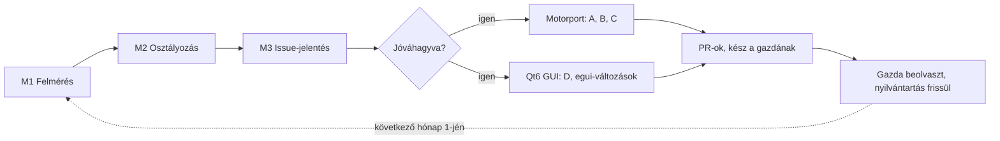

# CFA4-UPSTREAM-SYNC-001 – havi upstream-átvétel

**Állapot:** FINAL 1.0. A tulajdonos 2026-11-01-én jóváhagyta, a D1–D6 döntési pontokat a javasolt
alapértékkel (10. fejezet).

**Névhasználat:** a `python/tests/test_independence.py` miatt ez a dokumentum nem írja ki az upstream
szülőprojekt márkanevét. „Upstream” = a `NOTICE`-ban megnevezett szülőprojekt (a storytold szervezet
GitHub-tárolója), amelyről a CFA4 levált.

**Összefoglaló:** a CFA4 minden hónap 1-jén egy felhőben futó fejlesztő munkamenettel átnézi az
upstream előző hónapban megjelent kiadásait. A munkamenet osztályozza a változásokat, és a CFA4-hez
illőket adaptált portként, témánként külön PR-ban viszi át. A motorváltozások a CFA4 Rust-motorjába
kerülnek. Az upstream egui-felületén történt változások a CFA4 Qt6 GUI-jába kerülnek (a CFA4 egui
befagyasztva marad). Az első havi futás előtt egy egyszeri felzárkózás (U0) hozza be a 0.10 → 0.15
közötti lemaradást. A beolvasztás továbbra is kizárólag a gazdáé, a tulajdonos jóváhagyásával.

## 1. Cél és hatókör

A cél, hogy a CFA4 ne maradjon le az upstream biztonsági javításairól, hibajavításairól és hasznos
képességeiről, de csak azt vegye át, ami a CFA4 saját szabályaival nem ütközik.

**Hatókörben:**

- az upstream kiadásai (címkék, kiadási jegyzékek, a mögöttük álló PR-ok);
- azok a külső upstream könyvtárak, ahová az upstream a CFA4-ben még saját crate-ként élő kódot
  áthelyezte (craft-media: bitstream, isobmff, matroska), de csak a CFA4-ben meglévő crate-ek
  javításai miatt;
- a motorváltozások portja a Rust-motorba, az egui-változások átvitele a Qt6 GUI-ba
  (`python/cfa4_qt/`).

**Hatókörön kívül:**

- az upstream szervezet többi alkalmazása és az upstream forkjai;
- nem Linux x86_64 célplatformok (macOS, Windows, FreeBSD, Android, web, Flatpak-specifikus csomagolás);
- az upstream szervezeti infrastruktúrája (közös CI-akciók, craft-update önfrissítő, SonarCloud, CodeRabbit);
- a CFA4 egui felületének új funkciókkal bővítése (a befagyasztás marad).

## 2. Kiindulási tények (2026-11-01)

A CFA4 az upstream 0.10.0 kiadásáról vált le, azóta öt upstream kiadás jelent meg, egyiket sem vettük át.

| Tény | Érték | Forrás |
| --- | --- | --- |
| Leválási pont | upstream `cdf43fd` „Release 0.10.0”, 2026-10-20 | a CFA4 `main` története |
| Leválasztás | #20 (2026-10-23), márkaeltávolítás 2026-10-24, GPL-3 váltás #37 | CFA4 commitok |
| Azóta megjelent | 0.11.0 (10-22), 0.12.0 (10-23), 0.13.0 (10-25), 0.14.0 (10-28), 0.15.0 (10-31) | upstream kiadások |
| Becsült lemaradás | több mint 250 upstream PR, ebből a 0.13 a legnagyobb (kb. 70 biztonsági javítás) | kiadási jegyzékek |
| Upstream licenc | továbbra is MIT OR Apache-2.0, GPL-3-mal összeegyeztethető | upstream `LICENSE-MIT`, `LICENSE-APACHE` |
| Kiadási ütem | 11 nap alatt öt kiadás, havonta várhatóan 5–10 | kiadási dátumok |

**Eltérések, amelyek miatt nincs sima `git merge`:**

- a CFA4-ben minden crate, azonosító, környezeti változó és formátumazonosító át lett nevezve
  (`cfa4`), a márkanevet a `test_independence.py` tiltja;
- az upstream a bitstream, isobmff és matroska kódot a craft-media külső könyvtárba vitte (#2435), és
  közös modulszerkezetre állt át (#3410), így ezek javításai a CFA4 saját crate-jeibe kézzel portolandók;
- az upstream egui 0.37-re migrált és egy közös UI-könyvtár dokkolására állt át, a CFA4 egui-ja
  befagyasztva van, a felület jövője a Qt6 GUI;
- a CFA4-nek saját szabályai vannak, amelyek az upstreaméi felett állnak (`AGENTS.md`: csak Linux
  x86_64, GPL-3, nincs márkanév, saját Rust-motor elsődleges, gazda olvaszt be).

## 3. Alapelvek

Az átvétel képesség-alapú, adaptált port, és a CFA4 szabályai minden upstream szabály felett állnak.

1. **Port, nem merge.** Az upstream kódot és tesztet olvassuk és adaptáljuk a CFA4 nevekre és
   szerkezetre, nem cherry-pickelünk vakon. Ez a 2026-10-25-i elvet követi: csak azt vesszük át, ami
   a CFA4-ből hiányzik vagy jobbá teszi.
2. **Először ellenőrzés.** Minden upstream változásnál megnézzük, hogy a CFA4 a saját fejlesztése során
   nem oldotta-e már meg ugyanazt (pl. Rust 1.97, saját motor, Qt6). Ha igen, a nyilvántartásba
   „már megvan” kerül.
3. **A CFA4 szabályai előbb.** Az `AGENTS.md`, a `docs/coordination.md` és a tulajdonosi döntések
   győznek: csak Linux x86_64, nincs upstream márkanév, nincs `unsafe` (a `crates/platform`
   kivételével), a „soha ne omoljon össze” szabály, GPU-gyártófüggetlenség, a saját Rust-motor
   elsődleges. Az upstream `AGENTS.md` szabályait (pl. közös CI-akciók `@main`-ről) nem vesszük át.
4. **Licenc.** Az átvett upstream kód MIT/Apache, a CFA4 egésze GPL-3.0-or-later alatt terjeszti. Az
   upstream szerzői jogi közleményei a `NOTICE`, `LICENSE-MIT` és `LICENSE-APACHE` fájlokban
   maradnak. A nyilvántartásban minden átvett sor megnevezi az upstream PR-t és kiadást.
5. **Bizonyítás.** Minden átvett hibajavítás az upstream regressziós tesztjével (vagy annak CFA4-es
   megfelelőjével) együtt jön. A biztonsági javításokhoz a CFA4 szabálya szerint mutációs fuzz-teszt
   is kell, ha az upstreamben nincs.
6. **Egy PR = egy téma.** Kötegenként, crate- vagy funkcióterületenként külön PR, friss `main`-ből. A
   fejlesztő munkamenet nem olvaszt be, a PR leírásában jelzi a gazdának, hogy kész (2026-11-01-i döntés).
7. **Közös fájlok.** A `docs/*-parity.md`, `i18n/*.tsv`, `Cargo.toml` fájlokba csak saját sor kerül,
   átrendezés nélkül.

## 4. Osztályozás

Minden upstream PR pontosan egy kategóriát kap. Ez dönti el, hogy átvesszük-e, hová kerül és milyen
sorrendben.

| Kat. | Mi tartozik ide | Döntés | Hová kerül | Példa (0.11–0.15) |
| --- | --- | --- | --- | --- |
| A | Biztonság és stabilitás: rosszindulatú bemenet, pánik, túlméretes foglalás, holtpont | mindig átvesszük, első sorban | Rust-motor crate-jei; a befagyasztott egui-ba is, ha ott a hiba | 0.13 biztonsági köteg (H.264, HEVC, AV1, MXF, TTML…), #2764 vezérlőszerver-token, #3338 Symphonia-pánik |
| B | Hibajavítás és teljesítmény a motorban | átvesszük, ha a hiba vagy lassúság a CFA4-ben is fennáll | Rust-motor | #3456 H.264 export 20% gyorsabb, #3470 fast-start MP4, #3637 gyorsítótár-felszabadítás, #3548 wgpu-holtpont |
| C | Új motorképesség vagy parancs (formátum, effekt, szerkesztési művelet, interchange) | átvesszük, ha új képességet ad és nem ütközik más projekttel | Rust-motor + a Qt6 GUI-ban a hozzá tartozó felület (5. fejezet) | #2415 tömörítetlen QuickTime, #3038 animált WebP, #2819 F-Log, #1870 maxThreads |
| D | Felületi változás az upstream egui-ban | átvisszük a Qt6 GUI-ba (5. fejezet) | `python/cfa4_qt/`, a hiányzó motorrész a Rust-motorba | #3087 munkaterület-sáv, #3212 duplikált képkockák jelölése, #3522 csoportosított klipek |
| E | Fordítások (`i18n/*.tsv`) | átvesszük, ha nincs bennük márkanév | közös katalógusok, csak saját sorok | #3226 francia hiányzó sorok |
| F | Nem vesszük át: upstream infrastruktúra, nem Linux platform, egui-migráció, közös UI-könyvtárra átállás, csak SonarCloud-refaktor, önfrissítő, márka | kihagyjuk, egy sor indoklással | csak a nyilvántartásba | #3298 frissítő, #3249 egui 0.37, #2549 közös dokkolás, #3419 Windows-szabály |

Ha egy upstream PR több kategóriát érint (pl. motorjavítás + egui-felület), szétbontjuk: a motorrész
A/B/C, a felületi rész D. Kétes esetben a nyilvántartásba „tulajdonosi döntés” kerül, és a havi
jelentés rákérdez.

## 5. egui → Qt6 átvitel

Az upstream egui-ban megjelent minden felületi változás a CFA4 Qt6 GUI-jába kerül. A CFA4 egui-ja
csak hibajavítást és biztonsági javítást kap, ahogy a `docs/qt-parity.md` befagyasztási szabálya előírja.

**Döntési szabály egy upstream egui-változásra:**

| Upstream változás | CFA4 egui (befagyasztva) | CFA4 Qt6 GUI | Rust-motor |
| --- | --- | --- | --- |
| Hibajavítás vagy biztonsági javítás az egui-ban | átvehető, ha a hiba ott is megvan | ugyanaz a hiba javítva, ha a Qt6-ban is fennáll | ha a hiba a motorban van, ott javítva |
| Új panel, vezérlő, menüpont, párbeszédablak, viselkedés | nem kerül bele | megvalósítjuk a Qt6-ban | a hiányzó parancs, `*.inspect` mező vagy állapot ide kerül |
| Csak megjelenés, téma, ikon | nem kerül bele | átvesszük, ha a CFA4 témáival összhangban van, ikon csak sajátként rajzolva | nincs teendő |
| egui-verzió vagy közös UI-könyvtárra átállás (pl. egui 0.37, közös dokkolás) | nem kerül bele | nem releváns | nem releváns |

**A Qt6-megvalósítás szabályai:**

1. **A motor a forrás.** A felületi logika a Rust-motorban él (parancsok, `*.inspect`), a Qt6 GUI a
   `cfa4-cli serve` hídon át csak megjelenít és parancsot küld, ahogy a többi Qt6 panel. Ha az upstream
   a logikát az egui kódjában tartja, a portnál a motorba emeljük.
2. **Viselkedési referencia az upstream egui.** Az upstream egui kódja és tesztje (MIT/Apache)
   olvasható referencia. A Qt6 kód új Python kód (PySide6, GPL-3.0-or-later), nem soronkénti fordítás.
3. **Menü és beállítás.** A 2026-10-26-i követelmény szerint minden menüpontot kaphat funkció elérhető
   a menüből, és amelynek saját beállítás kell, kap beállítási panelt. A billentyűparancsok az upstream
   azonosítóival kerülnek be (`shortcuts.registerExternal`).
4. **Vezérlőcsatorna.** Új Qt6 állapot a `ui.set` / `ui.inspect` vezérlőcsatornán is elérhető, ahogy
   a `qt-parity.md` 1.11 sora előírja.
5. **Bizonyíték.** Minden átvitt funkcióhoz teszt a `python/tests/`-ben
   (pl. `test_real_engine_<funkció>_as_upstream`), a motorrészhez Rust-teszt. A Qt GUI-tesztek a
   2026-10-30-i döntés szerint a Qt6 GUI elkészültéig nem blokkolnak, de meg kell írni őket.
6. **Paritás-nyilvántartás.** A `docs/qt-parity.md` kap egy új „6. Upstreamből átvett felületi
   funkciók” fejezetet. Soronként: upstream kiadás és PR, a Qt6-megvalósítás, a bizonyíték. Ezek a
   sorok nem a CFA4 egui-val való paritást mérik, ezért az egui törlését nem blokkolják.
7. **Elsőbbség.** Ha egy upstream funkció a Qt6-ban egy még ❌ vagy 🟡 paritássort érint (pl. 5.3
   J/K/L, 5.6 trim monitor), a meglévő paritásmunka az első, az upstream változás arra épül.

**Példa:** az upstream 0.13 hozta a munkaterület-sávot (#3087). A `qt-parity.md` 3.13 sora szerint ez a
CFA4 egui-jában sincs meg. A motorba kerül a munkaterület-tartomány és a „Set Work Area Bar In/Out
Point” parancs. A Qt6 idővonalra kerül a sáv, a menüpont és a billentyű. A CFA4 egui nem kapja meg. A
`qt-parity.md` 6. fejezetébe új sor kerül.

## 6. Havi ciklus

Minden hónap 1-jén egy ütemezett feladat új, felhőben futó fejlesztő munkamenetet indít. Ez végigviszi
az M1–M4 lépéseket; a beolvasztás (M5) a gazdáé, a tulajdonos jóváhagyásával.

Amit a tulajdonos nem hagy jóvá, „tervezett” állapotban marad a nyilvántartásban, és a következő havi
futás újra elé teszi.

1. **M1 – Felmérés (csak olvasás).** A nyilvántartásból kiolvassa az utolsó átvett upstream címkét.
   Listázza az azóta megjelent kiadásokat és a mögöttük álló PR-okat, valamint a craft-media
   változásait a CFA4-ben meglévő crate-ekre (bitstream, isobmff, matroska). Mindig az upstream és a
   CFA4 eredeti, aktuális `main` ágát nézi, másolatot soha.
2. **M2 – Osztályozás.** Minden upstream PR kap egy kategóriát (4. fejezet), és megnézi, hogy a
   CFA4-ben már megvan-e. Az eredmény sorokként kerül a nyilvántartásba.
3. **M3 – Jelentés.** Egy GitHub issue-t nyit „Upstream-szinkron ÉÉÉÉ-HH” címmel: hány PR jött,
   kategóriánként mennyi, a tervezett kötegek, az átfedések más CFA4-projektekkel és a tulajdonosi
   döntést igénylő tételek.
4. **M4 – Végrehajtás.** A jóváhagyott kötegeket (D2 szerint) PR-onként viszi át, ebben a sorrendben:
   A → B → C → D → E. Minden PR: friss `main`-ből, egy téma, átvett tesztekkel, `cargo xtask ci`
   lokálisan, a teljes CI a `cfa4-full-validation` címkével, a leírásban a nyilvántartási sorok és a
   „kész a gazdának” jelzés.
5. **M5 – Beolvasztás és lezárás.** A gazda a szokásos módon, egyenként olvasztja be a PR-okat. Amikor
   egy hónap összes tétele beolvasztva vagy kihagyva, a nyilvántartás „utolsó átvett címke” mezője
   frissül. Ami nem fér bele egy hónapba, a következő hónap elejére görgetődik, és a jelentés jelzi.

**Nyilvántartás:** új fájl `docs/upstream/upstream-sync.md` (az U0-0 köteg hozza létre). A fejléc
rögzíti a leválási pontot és az utolsó átvett upstream címkét. Alatta egy táblázat, soronként egy
upstream PR:

| Upstream kiadás | Upstream PR | Cím (röviden) | Kat. | Döntés | CFA4 PR | Állapot |
| --- | --- | --- | --- | --- | --- | --- |
| 0.15.0 | #3338 | Symphonia-pánik elszigetelése | A | átvesz | – | tervezett |
| 0.13.0 | #3087 | munkaterület-sáv | D | átvesz (Qt6) | – | tervezett |
| 0.14.0 | #3298 | indítási frissítő | F | kihagy: önfrissítés nem kell | – | lezárva |

A „Döntés” mező értékei: átvesz, átvesz (Qt6), már megvan, kihagy (indokkal), tulajdonosi döntés. Az
„Állapot” mező: tervezett, folyamatban, PR nyitva, beolvasztva, lezárva.

## 7. U0 – egyszeri felzárkózás (0.10 → 0.15)

A havi ciklus csak akkor működik, ha előbb behozzuk a már meglévő, több mint 250 PR-os lemaradást.
Ezt egy külön fejlesztő munkamenet végzi, ugyanazokkal a szabályokkal, kötegekben.

| Köteg | Tartalom | Kategória | Hová |
| --- | --- | --- | --- |
| U0-0 | Nyilvántartás létrehozása, mind az öt kiadás PR-jainak osztályozása, „már megvan” ellenőrzés | – | `docs/upstream/upstream-sync.md` |
| U0-A1 | Videodekóderek: H.264, HEVC, AV1, VP8, VP9, MPEG-2, ProRes, DNx, APV, EXR, DNG korlátai | A | codec crate-ek |
| U0-A2 | Konténerek: MXF, AVI, Ogg, Matroska, ISOBMFF, MPEG-TS korlátai | A | konténer crate-ek |
| U0-A3 | Feliratok, interchange (TTML, FCPXML, AAF, OMF), modellfájlok (Whisper, Kokoro), vezérlőszerver-token | A | captions, interchange, speech, control |
| U0-A4 | 0.15 robusztusság: Symphonia, WAV, SCC, nem véges színértékek, .cube BOM | A | érintett crate-ek |
| U0-B | H.264 export gyorsítás, fast-start MP4, gyorsítótár-felszabadítás, wgpu-holtpont, 10 bites táblák, CPU-monitor | B | export, codecs, render, gpu |
| U0-C | Új importok és formátumok, F-Log, maxThreads, FCPXML/OTIO-javítások, szerkesztési parancsok motorrésze | C | érintett crate-ek |
| U0-D | A 0.11–0.15 egui-funkciói a Qt6-ba (munkaterület-sáv, duplikált képkockák, csoportosított klipek, feliratvágás és -másolás, áthúzott szöveg…) | D | `python/cfa4_qt/` + motor |
| U0-E | Fordítások | E | `i18n/*.tsv` |

**Sorrend és prioritás:** A `VISION.md` szerint a Qt6 az első. Az A-kötegek mégis előre jönnek, mert a
„soha ne omoljon össze” szabály az `AGENTS.md` §0 szerint minden funkciómunka felett áll, és ezek csak
motorkódot érintenek, a Qt6-munkát nem akasztják meg. Az U0-D közvetlenül a Qt6 GUI-t bővíti. Az U0
végén a nyilvántartás „utolsó átvett címke” mezője `v0.15.0` lesz, és onnan indul az első havi futás
(2026-12-01).

## 8. Ütemezett feladat

Felhőben futó ütemezett feladat: minden hónap 1-jén kora reggel (Europe/Budapest), első futás
2026-12-01. Nem kell hozzá a saját gép, nem a gazda munkamenete, és nem olvaszt be. Az önhosztolt
futtató (`cfa4-ubuntu-26-04`) csak a teljes CI-hez kell, ahogy most is.

A 2026-11-01-i döntés a gazda ütemezett ellenőrzéseit szüntette meg. Ez a feladat nem a gazdáé; a
tulajdonos a D1 ponttal külön jóváhagyta.

Az indítóprompt a tervet, a nyilvántartást és ezt a szabályrendszert olvastatja el a futással, és az
M1–M4 lépéseket írja elő. Ha a nyilvántartás még nincs a `main`-en (az U0 nem kész), a futás csak ezt
jelzi, és megáll.

## 9. Átfedések más CFA4-projektekkel

A projekthatár-szabály (2026-10-31) szerint ezeken a területeken a szinkron nem dolgozik tovább
magától. Jelzi a gazdának, a tulajdonos és a gazda dönt.

| Terület | Érintett CFA4-projekt | Upstream példa | Teendő |
| --- | --- | --- | --- |
| Smart Cut / Smart Render | #215, #228 (vár a Qt6-ig) | export- és kodekváltozások | a Smart Cut-részeket nem vesszük át, amíg a projekt vár |
| Stáblista | F10, #46 (vár a Qt6-ig) | grafikai sablonok, gördülő stáblista | jelzés, várakozás |
| Feliratok | SUBTITLE-STUDIO-PLAN-001 FINAL 1.2 | TTML/SCC/WebVTT javítások, feliratvágás, export formátumválasztás | A/B javítások mehetnek, funkciók egyeztetéssel |
| OpenTimelineIO | #44 OTIO-1.1 tesztorákulum | OTIO-export javítások | egyeztetés a #44-gyel |
| FCPXML | a szükséges FCPXML-export feladat | FCPXML-biztonság, üres ref javítás | egyeztetés |
| Médiahátterek | ADR-0005, #249, #263 | kodek-útválasztás, hardveres kódolás | a router táblát nem írjuk át egyeztetés nélkül |
| Szabadalmi vizsgálat | #248 LIC-03, ADR 0003 | H.265/AV1 kódolói változások | a `cfa4-restricted-extras` szabály szerint |

## 10. Döntési pontok (elfogadva 2026-11-01)

A tulajdonos mind a hat pontot a javasolt alapértékkel fogadta el (a terv egészének jóváhagyásával).

| # | Kérdés | Döntés |
| --- | --- | --- |
| D1 | Létrejöhet-e a havi ütemezett feladat, a 2026-11-01-i „nincs ütemezett ellenőrzés” döntés ellenére (az a gazdára vonatkozott)? | igen, havonta egyszer, csak fejlesztő munkamenet, nem olvaszt be |
| D2 | Mi indulhat külön jóváhagyás nélkül a havi futásban? (A Spec Kit D1 döntés szerint a fejlesztési feladatokhoz előzetes jóváhagyás kell.) | ennek a tervnek a jóváhagyása állandó jóváhagyás az A és B kötegekre; C, D, E a havi issue-ban jóváhagyásra vár |
| D3 | Az A-kötegek mehetnek-e a Qt6-migráció lezárása előtt? | igen, csak motorkód, a §0 szabály alapján |
| D4 | Az upstream egui hibajavításai bekerülhetnek-e a befagyasztott CFA4 egui-ba is? | igen, ha a hiba ott is megvan (a befagyasztás ezt megengedi) |
| D5 | Átvesszük-e a fordításokat (E)? | igen, márkanév nélkül, csak saját sorokkal |
| D6 | Figyeljük-e a craft-media könyvtárat is? | igen, de csak a CFA4-ben meglévő bitstream/isobmff/matroska crate-ek miatt |

## 11. Kockázatok és fázisok

**Kockázatok:**

| Kockázat | Hatás | Kezelés |
| --- | --- | --- |
| A kódok egyre jobban eltérnek (átnevezés, craft-media, Qt6) | a port egyre drágább | képesség-alapú port, „már megvan” ellenőrzés, upstream teszt mint referencia |
| Egy havi futás nem fér bele egy munkamenet keretébe | félbemaradt munka | a nyilvántartás „tervezett” állapota, átgörgetés a következő hónapra, kötegenként külön PR |
| Túl sok nyitott PR | a gazda túlterhelődik, ütközések | a `coordination.md` 20 PR-os korlátja: felette csak a jelentés készül el, PR nem nyílik |
| Márkanév kerül vissza | elbukik a `test_independence.py` | a port mindig a CFA4 nevekre fordít, a teszt a CI-ben fut |
| Az upstream licencet vált | átvétel jogi akadálya | M1-ben a licencfájlok ellenőrzése; váltás esetén megállás és tulajdonosi döntés |
| Egy upstream funkció ütközik a CFA4 iránnyal (pl. csak NVIDIA, nem Linux) | szabályszegés | F kategória vagy átdolgozás a gyártófüggetlenségi szabály szerint |

**Fázisok:**

1. **S0 – Jóváhagyás.** Kész (2026-11-01). A terv ezzel a fájllal a tárolóba kerül.
2. **U0 – Felzárkózás.** Nyilvántartás létrehozása (U0-0), majd az U0-A → U0-E kötegek PR-onként.
3. **S1 – Ütemezett feladat.** Létrehozva 2026-11-01-én, első futás 2026-12-01.
4. **Havi működés.** Minden hónap 1-jén M1–M4, a beolvasztás a gazdánál.
5. **Felülvizsgálat.** Három havi futás után (2027-03) rövid visszatekintés: mennyi ment át, mennyi
   maradt, kell-e a szabályokon igazítani.
