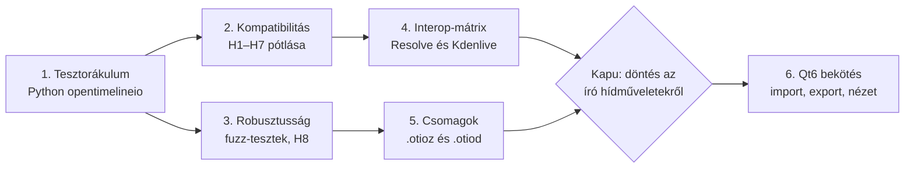

# CFA4 – OpenTimelineIO integrációs terv

**Dátum:** 2026-10-24 · **Tulajdonos:** ubuntuokos

> **Státusz: jóváhagyva** (2026-10-24, ubuntuokos). A tulajdonosi döntések a javaslatok szerint
> érvényesek. A 2. döntés (clean-room) feltétele teljesült: a #37 licenc-PR bekerült a `main`-be
> (`docs/licensing.md` §3, `AGENTS.md` §2), így a (b) változat él.

## Összefoglaló

A CFA4-ben már működik egy saját, tiszta Rust OTIO olvasó és író (`crates/interchange/src/otio.rs`).
A terv ezt fejleszti tovább, az OpenTimelineIO projekt hivatalos eszközeit pedig csak külső
tesztorákulumként használja, ahogy a projekt az ffmpeget is.

A C++ OTIO mag beépítése nem cél: ütközne a projekt „pure Rust”, `unsafe`-tilalom és pontos
`Tick`-idő szabályaival, és két párhuzamos idővonal-modellt hozna létre.

A munka hat fázisban halad:

1. Tesztorákulum beállítása (hivatalos `opentimelineio` Python-csomag, csak fejlesztői eszközként).
2. Kompatibilitási hiányok pótlása a meglévő Rust kódban.
3. Robusztusság: fuzz- és ellenséges bemenet tesztek a „Never crash” szabály szerint.
4. Interop-mátrix: valódi DaVinci Resolve és Kdenlive OTIO fájlok oda-vissza tesztje.
5. `.otioz` / `.otiod` csomagok támogatása a motorban.
6. Qt6 frontend bekötése (import, export, idővonal-nézet OTIO JSON-ból).

## Kiinduló állapot

A CFA4 a FilmCraft Linux-ra szűkített változata: Rust/Cargo médiamotor 51 crate-tel, mellette egy
PySide6/Qt6 prototípus, ami egy helyi, csak olvasó hídon (`python/cfa4_devtools/qt_control_bridge.py`)
éri el a motort.

Az OTIO-támogatás a `filmcraft-interchange` crate-ben él (L2 réteg, fájl I/O nélkül), az EDL, FCP7
XML, FCPXML, AAF, OMF és ALE mellett.

| Terület | Mai állapot |
| --- | --- |
| Olvasott és írt sémák | `Timeline.1`, `Stack.1`, `Track.1`, `Clip.1`/`Clip.2`, `Gap.1`, `Transition.1`, `Marker.1`/`Marker.2`, `ExternalReference.1`, `MissingReference.1`, `GeneratorReference.1`, `LinearTimeWarp.1`, `FreezeFrame.1`, `Effect.1`, `SerializableCollection.1` |
| Időkezelés | Pontos: a lebegőpontos `rate` értéket racionálisra illeszti, majd `Tick`-re alakítja |
| Beágyazott szekvenciák | Sávon belüli `Stack`-ként, rekurzióvédelemmel |
| Saját adatok | Effektek, címkék, linkek, csoportok, sávállapot a `metadata.filmcraft` kulcs alatt mennek oda-vissza |
| Tesztek | `crates/interchange/tests/otio.rs` és `src/otio.rs` RationalTime-teszt |
| Fájltípus | Csak `.otio` JSON; a `detect()` az `"OTIO_SCHEMA"` kulcsot keresi |
| Qt6 híd | Csak `perf.stats` és `sequence.inspect`; import/export még nincs bekötve |

## Miért nem a C++ OTIO mag

A C++ könyvtár beépítése a CFA4 mostani szabályai szerint több ponton is tiltott vagy kockázatos, a
meglévő Rust kód pedig a funkciók nagy részét már tudja.

- **Pure Rust:** a termékben csak Rust kód lehet; FFI és `unsafe` kizárólag a `crates/platform`
  crate-ben, az OS médiaAPI-khoz engedett.
- **Pontos idő:** a CFA4 minden vágási számítást `Tick`-ben végez (254 016 000 000/s). Az OTIO C++
  mag `RationalTime` lebegőpontos értékekkel dolgozik, így a két modell között folyamatos átváltás
  kellene.
- **Kettős modell:** a C++ magra épülő idővonal mellett a `filmcraft-project` modell is megmaradna,
  és a kettőt szinkronban kellene tartani.
- **Build és CI:** C++ fordítás, CMake és Python kötés kerülne a gyors, nem fordító PR-ellenőrzés
  mellé.

Az OpenTimelineIO projektből így két dolgot veszünk át: a nyilvános fájlformátum-specifikációt és a
hivatalos Python-csomagot fekete dobozos tesztorákulumként.

## Feltárt hiányok a mai OTIO-kódban

A kód a CFA4 saját oda-vissza mentését jól kezeli; a gyengébb pont a más programokból érkező fájlok
olvasása. A lista az `otio.rs` átolvasásán alapul, a valós hatást az 1. fázis tesztjei igazolják.

| # | Hiány | Hatás | Hely a kódban | Fázis |
| --- | --- | --- | --- | --- |
| H1 | Idegen metaadatok elvesznek: csak a `metadata.filmcraft` kulcsot olvassa | Resolve/Kdenlive saját adatai egy oda-vissza úton eltűnnek | `apply_clip_meta`, `fc()` | 2 |
| H2 | A metaadat-kulcs neve `filmcraft` | Márkacsere-feltétel a kiadáshoz (AGENTS.md CFA4 rész) | `fc()`, minden `json!` író | 2 |
| H3 | `ImageSequenceReference`: csak a `target_url_base` olvasódik, a minta (`name_prefix`, `start_frame`, `frame_zero_padding` stb.) nem | Képszekvencia egyetlen hibás fájlként érkezik | `media()` | 2 |
| H4 | Több médiahivatkozás (`media_references`) közül csak az aktív marad meg | Proxy/nagy felbontású változatok elvesznek; export csak `DEFAULT_MEDIA` | `clip()`, `media_ref()` | 2 |
| H5 | Szekvencia-beállítás idegen fájlnál alapértelmezett 1920×1080 | Rossz felbontás például 4K Resolve-projektnél | `sequence()`, `settings_for` | 2 |
| H6 | Szabványos OTIO effektek közül csak `LinearTimeWarp` és `FreezeFrame` értelmezett, a többi figyelmeztetéssel elvész | Idegen effektek nem jönnek vissza exportnál sem | `apply_clip_meta` | 2 |
| H7 | Átmenettípus csak `SMPTE_Dissolve` vagy `Custom_Transition` | Más programok átmenetei mind áttűnéssé válnak | `transition_json`, `track()` | 2 |
| H8 | Hatalmas vagy NaN `rate`/`value` értékek csak részben szűrtek | A „Never crash” szabály ellenőrzése szükséges (túlcsordulás `Tick::from_rational`-ben) | `read_rt`, `rate_from_f64` | 3 |
| H9 | Csak `.otio`; `.otioz` (zip) és `.otiod` (mappa) csomag nincs | Médiával együtt küldött projektek nem nyithatók meg | `Format::from_extension`, `detect` | 5 |
| H10 | Qt6 hídon nincs import/export művelet | A Qt frontend nem tud OTIO-t kezelni | `qt_control_bridge.py` | 6 |

## Ütemterv

Az első lépés a tesztorákulum: enélkül a kompatibilitási javítások hatása nem mérhető. A 2. és 3.
fázis párhuzamosan haladhat.

A felső sor a kompatibilitás útja, az alsó a robusztusságé; a kettő a Qt6 bekötésnél fut össze,
amely előtt a hídon engedélyezett író műveletekről döntés kell.

| ID | Feladat | Elfogadási feltétel |
| --- | --- | --- |
| OTIO-1.1 | `python/cfa4_devtools/otio_oracle.py`: a CFA4 által írt `.otio` betöltése az `opentimelineio` csomaggal | Minden meglévő tesztszekvencia hiba nélkül betölt; klipszám és időtartamok egyeznek |
| OTIO-1.2 | Fordított irány: az orákulummal generált minták minden olvasott sémára | A CFA4 import jelentése csak várt figyelmeztetéseket tartalmaz |
| OTIO-1.3 | CI-feladat `workflow_dispatch` / `cfa4-full-validation` címkére | A gyors PR-ellenőrzés nem lassul |
| OTIO-2.1 | Idegen metaadatok megőrzése (H1) | Ismeretlen `metadata` kulcsok változatlanul visszaíródnak |
| OTIO-2.2 | `cfa4` metaadat-kulcs, a `filmcraft` olvasása marad (H2) | Régi fájlok olvashatók, új fájlok `cfa4`-et írnak |
| OTIO-2.3 | `ImageSequenceReference` teljes mintával (H3) | Minta és képkocka-tartomány oda-vissza azonos; ha a projektmodell nem ismer képszekvenciát, előbb jelentés-figyelmeztetés |
| OTIO-2.4 | Több médiahivatkozás megőrzése (H4) | Nem aktív hivatkozások visszaíródnak |
| OTIO-2.5 | Felbontás idegen fájlból (H5) | Ismert felbontású fájl helyes szekvencia-beállítással nyílik |
| OTIO-2.6 | Szabványos effekt- és átmenetnevek leképezése (H6, H7) | Leképezési táblázat a crate README-ben; ismeretlenek metaadatban maradnak |
| OTIO-3.1 | Mutációs fuzz-teszt az OTIO importra | 10 000 mutáció pánik nélkül |
| OTIO-3.2 | Szélsőérték-tesztek: 0, negatív, NaN, 1e308 `rate`/`value`, mély beágyazás (H8) | Hiba vagy jelentés, soha pánik; regressziós tesztek |
| OTIO-4.1 | Korpusz-tároló, sha256-tal rögzített letöltés | `cargo xtask corpus` letölti és ellenőrzi |
| OTIO-4.2 | Interop-mátrix: Resolve és Kdenlive minták import → export → orákulum | Eredménytábla a `docs/` alatt; eltérések issue-ként |
| OTIO-5.1 | `.otioz` / `.otiod` olvasás a motor rétegben, GPL-3-kompatibilis licencű zip crate-tel (H9) | Útvonal-kitörés (`../`) és zip-bomba hibát ad |
| OTIO-5.2 | `.otioz` írás médiagyűjtéssel | Az írt csomag az orákulumban megnyílik |
| OTIO-6.1 | Híd: OTIO export művelet (H10) | QThread-ben fut, hibát a felületen jelez |
| OTIO-6.2 | Híd: OTIO import visszavonható tranzakcióval | Egy visszavonás teljesen visszaállítja a projektet |
| OTIO-6.3 | Qt6 menü: Fájl ▸ Import / Export OpenTimelineIO, jelentés-párbeszéd | A jelentés minden figyelmeztetést megjelenít |
| OTIO-6.4 | Qt6 idővonal-nézet a szekvencia OTIO JSON-jából, csak olvasó | A Qt réteg nem függ a belső Rust modelltől |

## Tesztelés és minőségkapuk

Minden OTIO-feladat csak zöld `cargo xtask ci` mellett kerülhet be, egy feladatazonosítóval
commitonként (például `OTIO-2.3: ImageSequenceReference`).

- **Rust kapuk:** `cargo fmt --check`, `cargo clippy --workspace --all-targets -- -D warnings`,
  `cargo test --workspace`, `cargo xtask layers`, `cargo xtask assets`.
- **Never crash:** minden új olvasó ág kap csonkítás-, bitflip- és sérült méret tesztet
  `catch_unwind` alatt; minden javított összeomlás kap regressziós tesztet.
- **Orákulum-tesztek (Python):** a hivatalos `opentimelineio` csomag betölti a CFA4 által írt
  fájlt, és fordítva; az eredményt sémaszinten hasonlítjuk össze. Csak `workflow_dispatch` vagy
  `cfa4-full-validation` címke esetén fut, a gyors PR-ellenőrzés nem fordít.
- **Valódi fájlok:** Resolve- és Kdenlive-mintafájlok külön korpusz-tárolóban, commithoz és
  sha256-hoz rögzítve; a CFA4 tárolóba nem kerülnek bináris tesztanyagok.
- **Qt6:** a híd minden új műveletére ellenséges paraméter teszt a `python/tests` alatt.

## Licenc és clean-room szempontok

Az OpenTimelineIO és kiegészítői Apache-2.0 licencűek, ami kompatibilis a CFA4 GPL-3.0-or-later
licencével.

- **Licenc:** a CFA4 a #37 óta GPL-3.0-or-later (`LICENSE`, `docs/licensing.md`). A #38 (ADR F10) és
  a #40 (GStreamer) még nyitott, és szintén módosítja a licencszabályokat; ezeket a mostani
  `main`-hez kell igazítani, hogy ne írják felül a #37 szabályait.
- **Clean-room:** a `docs/licensing.md` §3 és az `AGENTS.md` §2 szerint egy megengedett licencű
  implementáció portolása is lehetséges, ha bekerül a „Reused code register”-be. Az OTIO-nál ezért
  a hivatalos (Apache-2.0) forráskód olvasható és mintának használható; a kodekekre továbbra is a
  specifikáció alapú alapértelmezés érvényes. Ha OTIO-kód kerül át, az Apache-2.0 jelölés a
  `NOTICE`-ba és a nyilvántartásba kerül.
- **Orákulum:** a Python `opentimelineio` csomag futtatása fekete dobozként ugyanaz a helyzet, mint
  az ffmpeg tesztorákulumként: nem linkeljük és nem szállítjuk.
- **Raven és Toucan:** C++ kódjuk nem kerül a termékbe. A Toucan opcionálisan render-orákulum lehet
  (OTIO → képkocka összevetés a CFA4 renderrel), külső programként.

## Tulajdonosi döntések

Mindegyiknél: miről szól, mik a lehetőségek, és mi a jóváhagyott döntés.

1. **Metaadat-kulcs átnevezése (`filmcraft` → `cfa4`)** — *döntés: (a)*
   - Miről szól: amikor a CFA4 OTIO fájlt ment, a saját, OTIO-ban nem létező adatait (effektek,
     címkék, sávhangerő) egy „fiókba” teszi a fájlon belül. Ennek a neve ma `filmcraft`.
   - Lehetőségek: (a) átnevezés `cfa4`-re, a régi `filmcraft` fiók olvasása megmarad; (b) marad a
     régi név.
   - Döntés: (a), a 2. fázisban, a közös márkacsere-tervvel összehangolva.
2. **Clean-room szabály enyhítése** — *döntés: (b)*
   - Miről szól: a „clean-room” azt jelenti, hogy egy formátumot csak a nyilvános leírásából
     szabad megírni, más programok forráskódjába belenézni tilos.
   - Lehetőségek: (a) csak az OTIO dokumentációja; (b) szűk kivétel: az OTIO hivatalos
     (Apache-2.0) forráskódja is olvasható, a kodekekre a szigorú szabály marad.
   - Döntés: (b). A feltétel (a licenc-PR bekerülése) teljesült a #37-tel.
3. **Python tesztorákulum fejlesztői függőségként** — *döntés: (a)*
   - Miről szól: az OTIO hivatalos Python-csomagja (`opentimelineio`) dönti el, hogy a CFA4 által
     írt fájl szabályos-e.
   - Lehetőségek: (a) a `pyproject.toml` külön fejlesztői csoportjába, verziókorláttal; (b) kézi
     telepítés.
   - Döntés: (a). A felhasználókhoz nem jut el.
4. **Író műveletek a Qt6 hídon** — *döntés: lépcsőzetesen*
   - Miről szól: a híd ma csak olvasni enged. Az OTIO import a projektet módosítja, az export fájlt
     ír.
   - Lehetőségek: (a) mindkettő, az import visszavonható; (b) csak export; (c) egyik sem.
   - Döntés: először (b), csak export; az import akkor, amikor a motor parancsrendszerén keresztül,
     egyetlen visszavonható lépésként fut.
5. **Korpusz-tároló a mintafájloknak** — *döntés: (a)*
   - Miről szól: valódi, Resolve- és Kdenlive-mintafájlok gyűjteménye a tesztekhez; ilyen fájlok
     nem kerülhetnek a CFA4 tárolóba.
   - Döntés: új, külön tároló (például `ubuntuokos/cfa4-otio-corpus`), saját vagy szabad licencű
     felvételekből készült mintákkal.
6. **Toucan render-orákulum** — *döntés: (b), később*
   - Miről szól: a Toucan egy OTIO idővonalból képkockákat számol, amit a CFA4 renderével lehetne
     összevetni.
   - Döntés: akkor vesszük elő, amikor a renderelés pontossága kerül előtérbe.

## Ne felejtsük el

Ezek nem az OTIO-terv feladatai, de hatnak rá; mindegyikhez kell egy felelős.

- [x] **Licenc a `main`-ben:** a #37 bekerült (GPL-3.0-or-later, `deny.toml`, `docs/licensing.md`).
- [ ] **#38 és #40 igazítása:** mindkettő ugyanazokat a fájlokat módosítja, eltérő szabályokkal.
  Javaslat: a #38 ADR-jét és VISION.md-módosításait a #37 szabályaihoz igazítva hozzuk be; a
  #40-ből a licencrészek kikerülnek, csak a GStreamer marad.
- [ ] **ADR F10 nyitott kérdései:** OpenFX-kivétel, CLA vagy DCO, NVENC — az első külső GPL-kód
  beemelése előtt.
- [ ] **Közös márkacsere-terv:** a `filmcraft` metaadat-kulcs mellett a crate-nevek
  (`filmcraft-*`), a projektfájl formátuma és a menük is érintettek; az OTIO-kód ne fusson előre
  egyedül.
- [ ] **Kapcsolat a FilmCraft eredetivel:** GPL-3 után a FilmCraft újdonságai átvehetők, de a CFA4
  módosításai nem mehetnek vissza. Ha követni akarjuk az eredetit, az `interchange` crate-et inkább
  bővíteni kell, mint átírni.
- [ ] **Személyes adatok az exportban:** az OTIO export ma abszolút utakat ír
  (`/home/<felhasználónév>/…`). A Qt6 export alapból relatív utakat írjon (`relative_to`).
- [ ] **Resolve-hozzáférés:** a 4. fázishoz kell valaki, aki Linuxon futtatja a DaVinci
  Resolve-ot; ellenőrizni kell, hogy az ingyenes változat tud-e OTIO-t exportálni.
